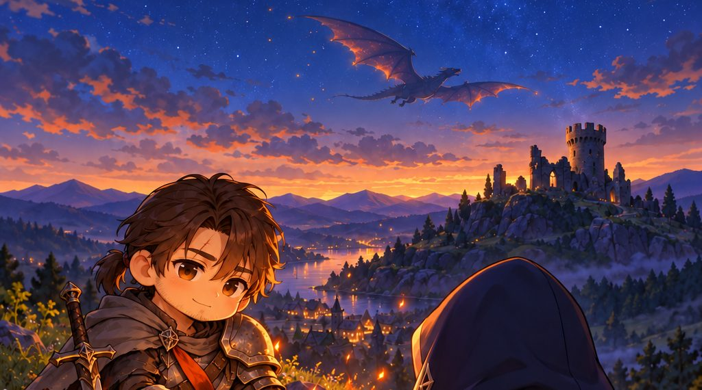
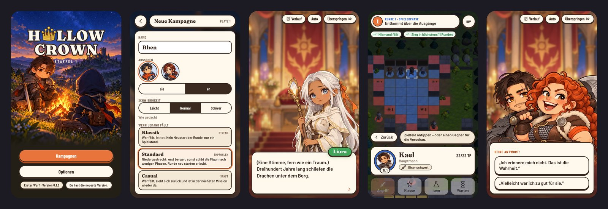
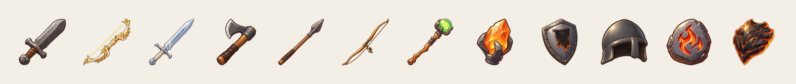
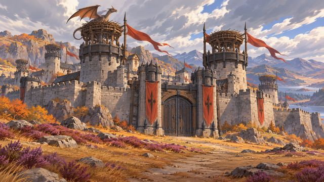
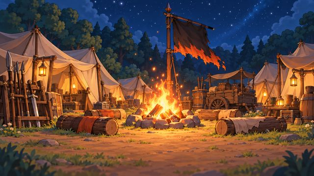
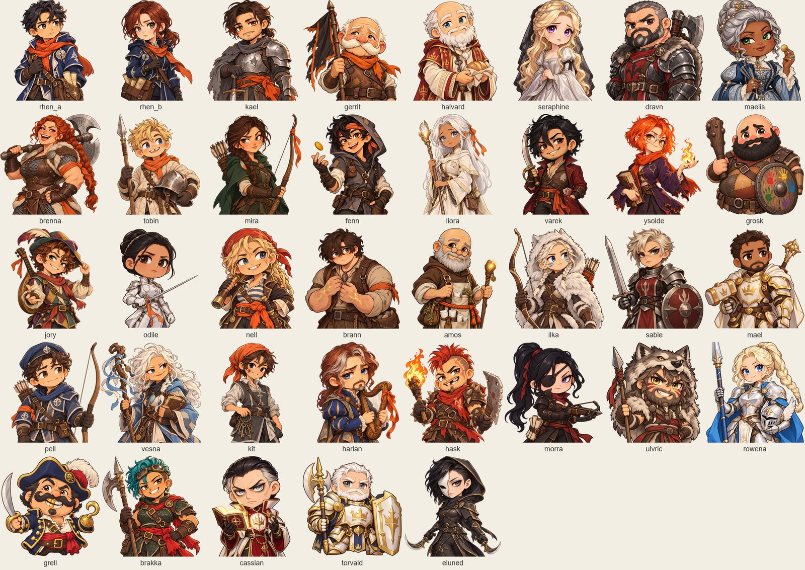
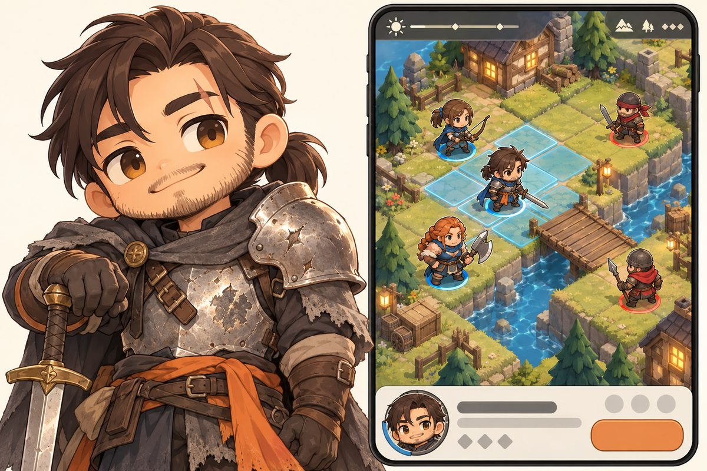

<div align="center">



# Hollow Crown

**Der König ist tot. Die Krone ist verschwunden. Die Drachen erwachen.**

Ein rundenbasiertes Taktik-RPG fürs Handy im Hochformat: Fire Emblem trifft Battle Brothers.<br>
Läuft im Browser auf Handy, Tablet und PC und lässt sich als App installieren.

[**▶ Jetzt spielen**](https://maschoeller.github.io/hollow-crown/) · [Konzept](concept/README.md) · [Entwicklung](#entwicklung)


</div>

---

## Worum es geht

Eine kleine Söldnertruppe aus Außenseitern gerät in einen Krieg, der nicht ihrer ist. Du führst sie durch Gefechte, versorgst sie im Lager und versuchst, so viele wie möglich heimzubringen. Jede Figur kann dauerhaft fallen, und gerade weil die Welt freundlich und rund gezeichnet ist, wiegt jeder Verlust schwer.

<p align="center">
  
  <br><sub>Titel · neue Kampagne · Dialog · Zug im Prolog-Gefecht · Antwortwahl (echte Aufnahmen aus dem Spiel)</sub>
</p>

## Was Hollow Crown ausmacht

| | |
|---|---|
| ⚔️ **Lesbare Taktik** | Phasen wie in Fire Emblem, Waffendreieck, Elementkreis, Gelände und Statuseffekte. Kampfvorschau und Gefahrenzonen zeigen alles; eine Niederlage soll sich wie ein eigener Fehler anfühlen. |
| 🛡️ **Ausrüstung ist der Charakter** | Paperdoll, Gewicht, Beute mit Affixen und Runen. Waffen und Accessoires bestimmen Werte, Reichweite und Element und lehren Fähigkeiten. |
| 🕯️ **Jeder zählt** | Permadeath in Stufen: niedergestreckt → Narbe → Tod. Jede Figur hat eine Stimme, Beziehungen und Narben, und die Truppe trauert um ihre Gefallenen. |
| 🏰 **Eine Heimat, die mitwächst** | Lager und später eine Burg: Verwundete versorgen, Gefährten anwerben, schmieden, verzaubern und am Lagerfeuer reden. |
| 🐉 **Feinde, die sich erinnern** | Benannte Leutnants fliehen bei 0 TP, statt zu sterben, und kehren mit Groll gegen ihren Vertreiber zurück. |
| 👍 **Daumenfreundlich** | Ein Zug lässt sich mit einer Hand spielen, gespeichert wird nach jeder Aktion. Keine Energie, kein Pay-to-win. |

<p align="center">
  
</p>

## Die Welt Valmora

<p align="center">
  
</p>

<table>
  <tr>
    <td width="33%"><br><sub>Aurenhall im Winter</sub></td>
    <td width="33%"><br><sub>Grauwacht</sub></td>
    <td width="33%"><br><sub>Salzpass</sub></td>
  </tr>
  <tr>
    <td><br><sub>Lager unterwegs (Heimat in Akt 1)</sub></td>
    <td><br><sub>Glutdom in Aurenhall</sub></td>
    <td><br><sub>Urtempel und Vhaelyras Hort</sub></td>
  </tr>
</table>

## Die Truppe

<p align="center">
  
</p>

Runder Chibi-Stil, warm und freundlich, mit ernsten Themen darunter. Die Brettfiguren entstehen aus diesen Entwürfen per Bild-zu-3D und stehen als kleine Dioramen auf der Karte.

<p align="center">
  
  <br><sub>Stilprobe: Kael und die angestrebte Diorama-Karte (Mockup)</sub>
</p>

## Status

🎮 **Proof of Concept spielbar:** Prolog, Kapitel 1 und 2 (DE/EN) mit Lager, Speichern und PWA.
🗺️ **In Planung:** Staffel 1 mit drei Akten und 25 Story-Missionen, Akt für Akt veröffentlicht. Planung in [`concept/`](concept/README.md), Einstieg über den [Game Brief](concept/20-game-brief/brief.md).

Spielen unter **https://maschoeller.github.io/hollow-crown/**; als App installierbar über „Zum Startbildschirm hinzufügen“.

## Entwicklung

Node 22+, pnpm 10, Python 3.12+ (nur für die Assets, Pakete per `pip install -r tools/art/requirements.txt`). Bilder unter `art/` liegen in Git LFS (`git lfs pull`).

```bash
pnpm install
pnpm art:build      # art/ → public/assets
pnpm dev            # http://localhost:5173
pnpm test           # Vitest (Kern, Replays)
pnpm test:e2e       # Playwright (iPhone 13, Pixel 7, iPad quer, Desktop)
pnpm lint           # ESLint (inkl. Schichtenregeln) + Typecheck
pnpm content:check  # YAML-Validierung, Referenzen, DE/EN
pnpm sim m1_2 --runs 50   # KI gegen KI fürs Balancing
```

| Ordner | Inhalt |
|---|---|
| `src/core` | reiner Regelkern als Commands und Events, deterministisch mit Seed-RNG |
| `src/content` | Laden und Prüfen der YAML-Inhalte (Zod) |
| `src/render` | Babylon.js-Brett |
| `src/ui`, `src/app` | Oberfläche und App-Zustand (Preact) |
| `content/core/` | Regeln, Spielwerte, UI-Texte (DE/EN) |
| `content/acts/actN/` | Akt-Inhalte: Karten, Missionen, Dialoge |
| `art/` | Asset-Quellen (Git LFS), Prompt-Protokolle in `art/prompts/` |
| `concept/` | Game Brief, GDD, Narrative, Art Direction, UX, Architektur, Epics |

Regeln für Beiträge (Branches, Prüfungen, Akt-Release) stehen in [`AGENTS.md`](AGENTS.md).

## Tech

TypeScript · Vite · Babylon.js · Preact (HTML-UI) · Vitest · Playwright · PWA (später Capacitor)

---

<sub>Grafiken, Musik, Soundeffekte und Stimmen dieses Spiels wurden mit Hilfe generativer KI-Werkzeuge erstellt (OpenAI, ElevenLabs, Tripo) und von Menschen ausgewählt, bearbeitet und zusammengestellt. Herkunft und Prompts: [`art/prompts/`](art/prompts/), Lizenzlage: [`concept/23-art-direction/licensing.md`](concept/23-art-direction/licensing.md).</sub>
