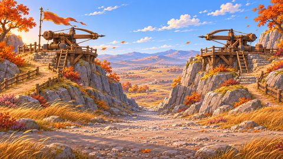
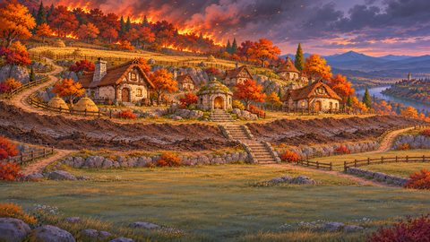
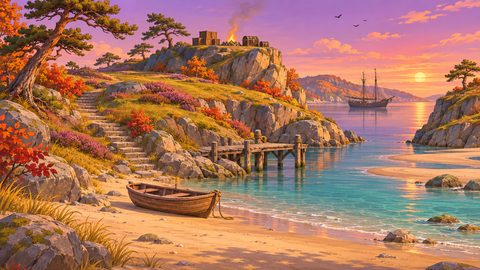
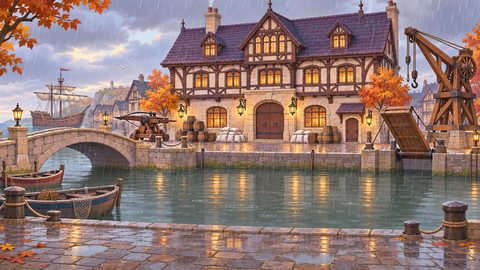
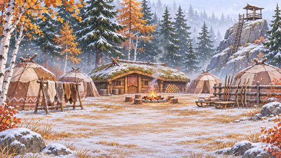
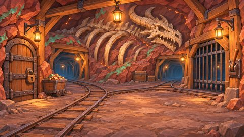
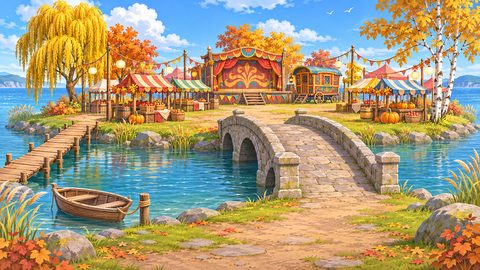
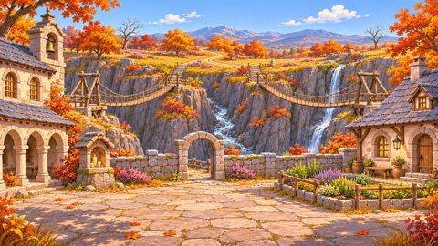

# Abnahme: Ortsbilder Akt 2 (2026-11-07)

**Kurzfassung:** Die 7 fehlenden Ortsbilder von Akt 2 sind da (2-1, 2-4, 2-6, 2-7, N4, N5, N6), jedes im ersten Versuch und im Stil der vorhandenen Orte. Akt 2 spielt im Herbst, nur N4 hat frühen Schnee wie seine Karte. Im Spiel sind sie noch nicht, weil es Akt 2 im Content noch nicht gibt. Die Missions-Stories binden sie ein, den Weg beschreibt Epic 11 unter „Ortsbilder“. **Status: abgenommen vom Produktinhaber am 2026-11-07, alle sieben ohne Änderung.**

Gesamtansicht: [akt2-ortsbilder-kontaktbogen.jpg](akt2-ortsbilder-kontaktbogen.jpg)

| Mission | Bild | Kurz |
|---|---|---|
| 2-1 Windscharte |  | Passscheitel im trockenen Flusstal, zwei Ballisten auf Felsnasen, dahinter die Herbstebene. Morgen, Wind. |
| 2-4 Brandschneise |  | Das Dorf am Brandhang auf drei Stufen, oben brennt der Wald, vor dem Schrein die frische Schneise. Abend. |
| 2-6 Krähenholm |  | Schmugglerinsel: Strand mit Boot, Klippe mit Goldkisten und Signalfeuer, Grells Schiff in der Bucht. Abend. |
| 2-7 Kontor |  | Kontor der Herzogin am Hafenbecken, eine Steinbrücke mit Balliste, Kran mit Klappsteg. Regenmorgen. |
| N4 Clanlager |  | Jägerlager im ersten Schnee, Langhaus und Zelte, Ilkas Hochsitz auf der Felsnase. Morgen. |
| N5 Kupfermine |  | Stollenhalle mit Lore, verschlossener Tür und Fallgatter mit Hebel, Drachenknochen in der Wand. Innen. |
| N6 Aue-Markt |  | Herbstmarkt auf der Flussinsel mit Gauklerbühne, Steinbrücke und Holzsteg, Boot am Ufer. Mittag. |

Details: Herkunft, Prüfung, Ablage

- **Quellen:** Entwürfe `concept/27-ueberarbeitung/levels/s2_*.yaml` (Ort, Tageszeit, Wetter, Landmarken), `geografie-valmora.md`, Art Direction §2.4 (Akt 2 Herbst), §5.2 (16:9, Mitte wichtig, unteres Drittel ruhig); Jahreszeit je Karte nach Story 15.15 (N4 `season: winter`).
- **Erzeugung:** ChatGPT (Plus, Konto `maschoeller`) über Claude in Chrome, ein Chat für alle 7: https://chatgpt.com/c/6aeef3ce-f978-83eb-a104-7f42c320ecb8. Referenzen `erlbach.png`, `wachturm.png`, `brandhang.png`. Je 1 Versuch.
- **Auflagen `licensing.md` §6:** Prompt, Tarif, Konto, Chat, Referenzen und menschlicher Anteil je Bild in `art/prompts/loc_<id>.md`; Originale unverändert mit C2PA-Metadaten in Git LFS unter `art/mockups/locations-s1/<id>.png`; keine Namen fremder Werke im Prompt.
- **Prüfung je Bild:** alle in den Entwürfen genannten Landmarken sichtbar (Details in den Prompt-Dateien); keine Menschen, keine Tiere bis auf Vogelpunkte, kein Text.
- **Was du bewerten könntest:** 2-4 zeigt das Dorf vom Brandhang sinngemäß, nicht exakt dieselbe Ansicht wie `brandhang.png`. N6 ist bewusst sehr bunt, als Kontrast zum Rest von Akt 2.
- **Build und Budget:** `pnpm art:build` baut die Bilder noch nicht (nur Ids aus `ACT1_LOCATIONS`), also kein Einfluss auf den ersten Download oder act1. Einbindung in Paket act2 siehe Epic 11.
- **Vorschaubilder** hier sind verkleinerte JPGs (480 × 270), nicht die Spieldateien.

## Nachtrag 2026-11-09: 2-5 Silberquell (Story 11.16)

**Kurz:** Das achte Ortsbild, für 2-5 „Die verstoßene Leibwache“. Erzeugt und geprüft von der lenkenden Session, eingebunden mit Story 11.16 (`ACT2_LOCATIONS`, Paket act2, `place` und Szenen-`background` `silberquell`). **Status: Abnahme durch den Produktinhaber offen.**

| Mission | Bild | Kurz |
|---|---|---|
| 2-5 Silberquell |  | Klosterhof mit Schrein und Hospiz, dahinter die Eisenschlucht mit zwei Hängebrücken und Wasserfall im Osten, der Nordrand eine Stufe höher. Mittag. |

Details

- **Herkunft:** `art/prompts/loc_silberquell.md` (Prompt, Tarif, Konto, eigener Chat, Referenzen `windscharte.png`, `kraehenholm.png`, `brandhang.png`, 1 Versuch); Original `art/mockups/locations-s1/silberquell.png` (1672 × 941) in Git LFS.
- **Prüfung:** Landmarken des Entwurfs `s2_2_5_silberquell` sichtbar (Hof, Tor, Schrein, Hospiz, zwei Hängebrücken, Wasserfall, Nordrand mit Treppe); keine Menschen, kein Text.

