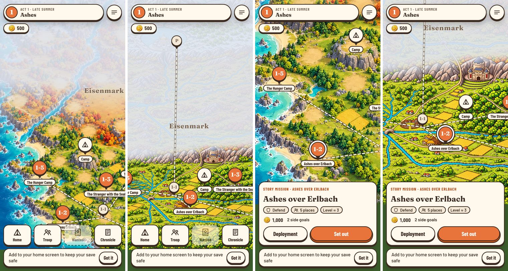
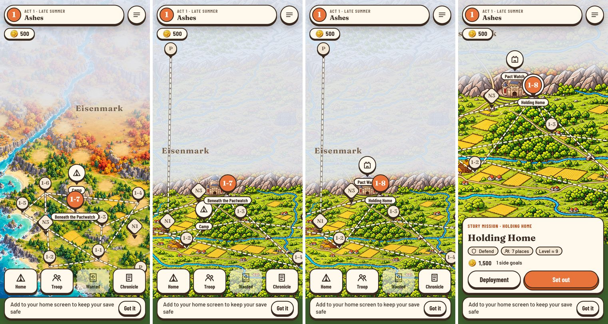

# Weltkarte v5 im Spiel (Story 15.7)

**Kurz:** Die Weltkarte zeigt jetzt `map_v5.png` in 3 × 3 Kacheln, die 12 Stadtbilder auf ihren Plateaus, Nebel nach den Regionsgrenzen und die Knoten von Akt 1 an den Orten der neuen Folge. Nah gezoomt ist sie auf dem Handy scharf. **Offen für dich:** Zustandsvarianten der Stadtbilder (Art-Log 2026-11-05).

Von links: vorher Übersicht, nachher Übersicht, vorher nah, nachher nah (375 × 812, Ton aus).

Weitere Bilder und Einzelheiten

Von links: vorher mit 1-7 offen, nachher mit 1-7 offen (Heimat noch Lager), nachher mit 1-8 offen und der Burg als Heimat, dazu nah.

- **Schärfe:** [after-m1_2-near.jpg](after-m1_2-near.jpg) zeigt die nahe Stufe mit Tipp-Zoom (aufgenommen mit DPR 3, hier halb so groß gespeichert).
- **Rückfall:** [fallback-m1_2-near.jpg](fallback-m1_2-near.jpg): Kachel unten Mitte und das Stadtbild von Erlbach entfernt. Statt einer Lücke zeigt sich dort das weichere Übersichtsbild, auf dem Plateau ein Haus-Zeichen.
- **Steine:** ein Stein je Ort. An Orten mit Stadtbild steht er rechts vor dem Plateau. Varnhold trägt 1-1 und N1, die Paktwacht 1-6 bis 1-8. Die Burg-Heimat steht auf dem Bergfried, das Lager vor 1-6 im Wald zwischen Varnhold und dem Schrein.
- **Nebel:** Akt 1 südlich des Grauen Kamms, Akt 3 nördlich des Moränenriegels. Krähenholm gehört zu Akt 2. Der Prolog-Stein steht in Aurenhall im Nebel, sein Weg nach Varnhold zeigt die Flucht nach Süden.
- **Bilder neu erzeugen:** `node tools/art/worldmap-shots.mjs <präfix> m1_2 m1_7` gegen den laufenden Dev-Server (`BASE`, `HOME_KIND=castle`).

