# Akt 1 im Spiel: Entwürfe mit Höhenstufen (Abnahme)

**Kurzfassung**
- Alle 12 abgenommenen Entwürfe ersetzen die alten Karten. IDs bleiben, Spielstände und Weltkarte passen.
- Höhe gezielt: 1-4 drei Stufen, 1-6 und 1-8 Terrassen und Wehrgänge, N1 Dächer mit Leitern; Prolog, 1-1, 1-3, 1-5, N2 mit Akzenten; 1-2, 1-7, N3 flach.
- Ereignisse: Beben im Prolog, Felsrutsch in 1-4, Burgtor mit Hebel in 1-6, Einsturz in 1-7.
- Normal läuft die Kampagne 18 von 20 Mal durch, Leicht 20 von 20. Schwer: alle Story-Missionen im Korridor (30–70 %).
- Neu: Gelände Dach, Wolfsreiter zu Fuß (in Staffel 1 reitet niemand), Zelte in 1-5, Ortsbilder 1-3 und 1-4, Kampagnenfolge nach Missionsliste (Varek in N2).

| | | |
|---|---|---|
| 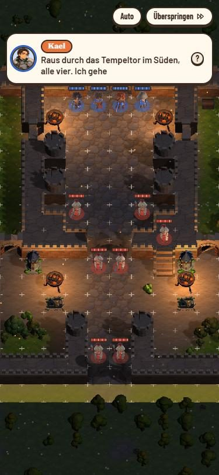 Prolog | 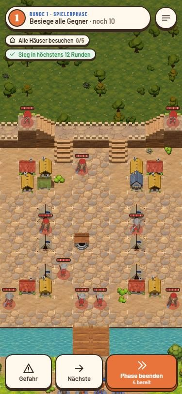 1-1 | 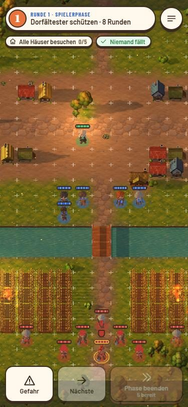 1-2 |
| 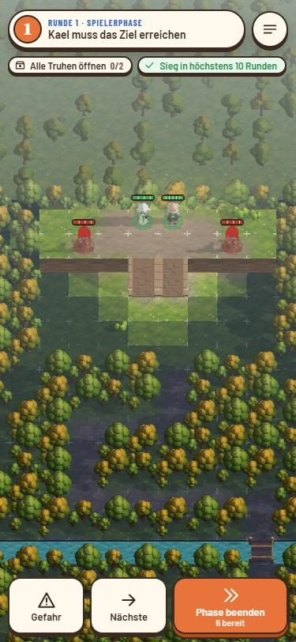 1-3 | 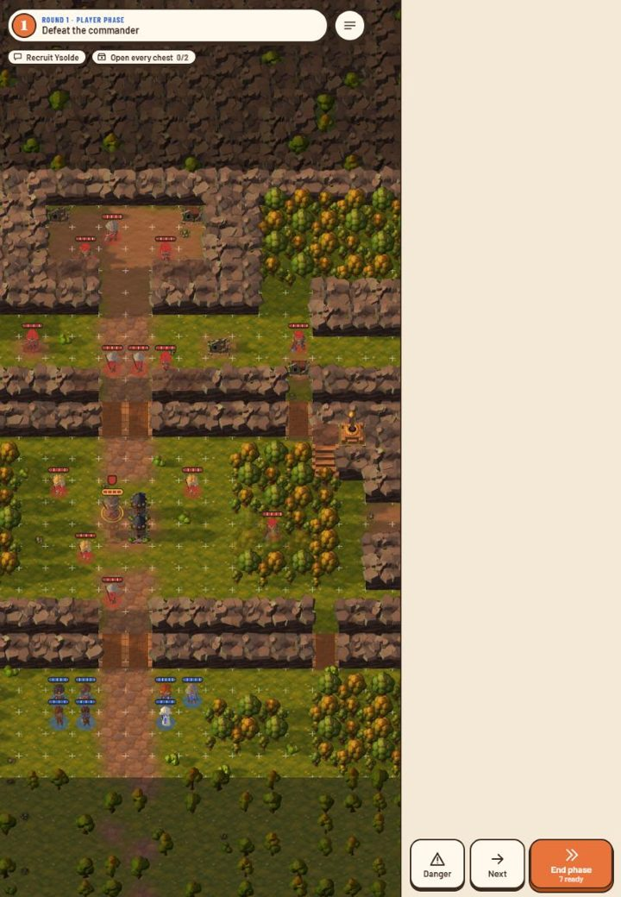 1-4 | 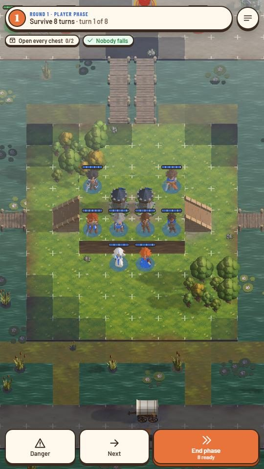 1-5 |
| 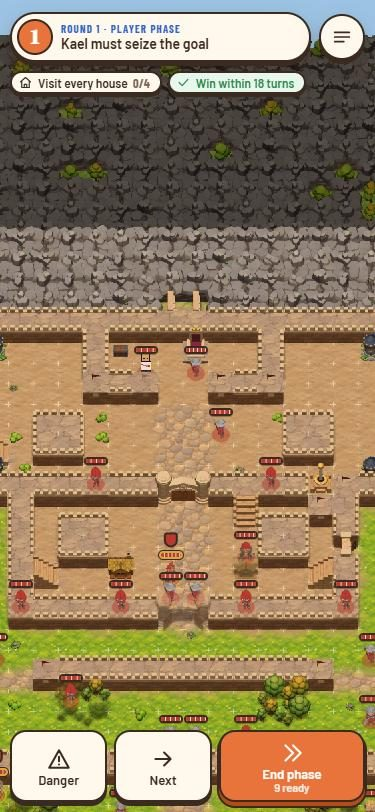 1-6 | 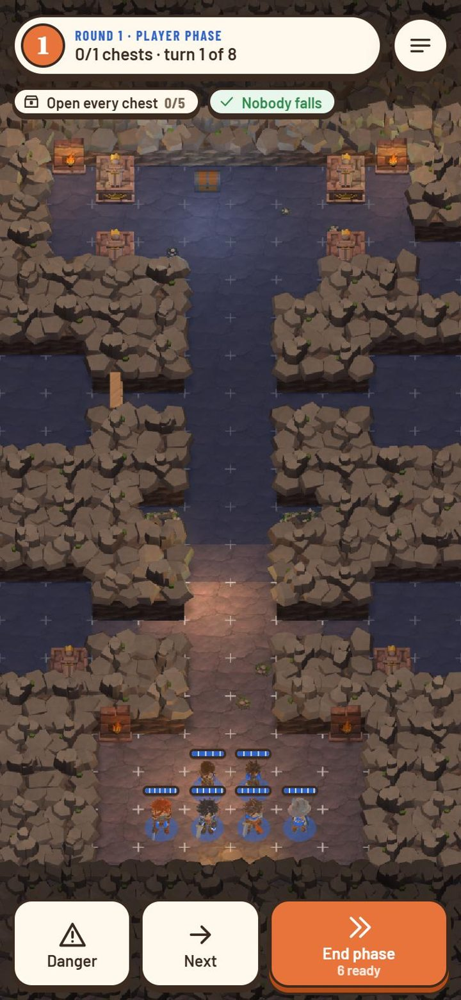 1-7 | 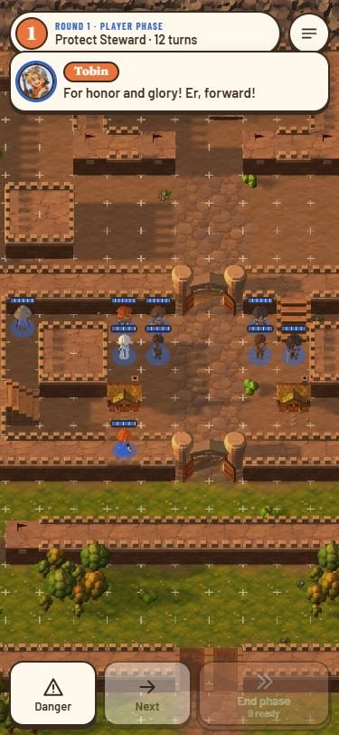 1-8 |
| 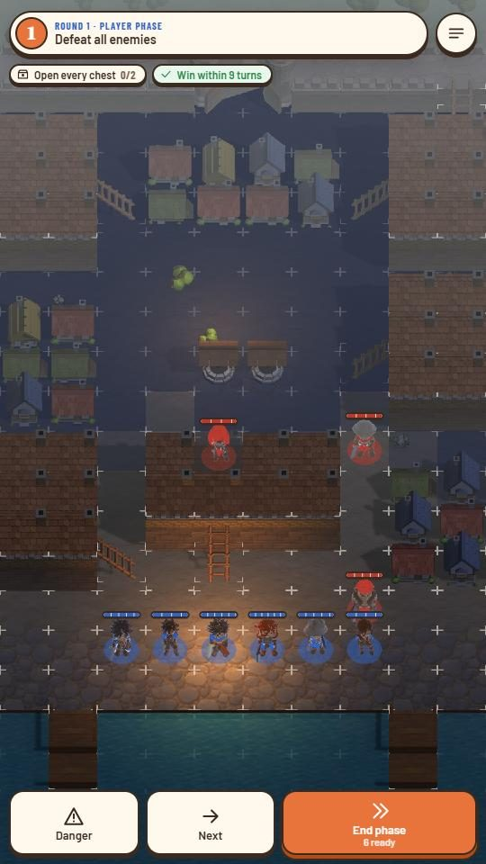 N1 | 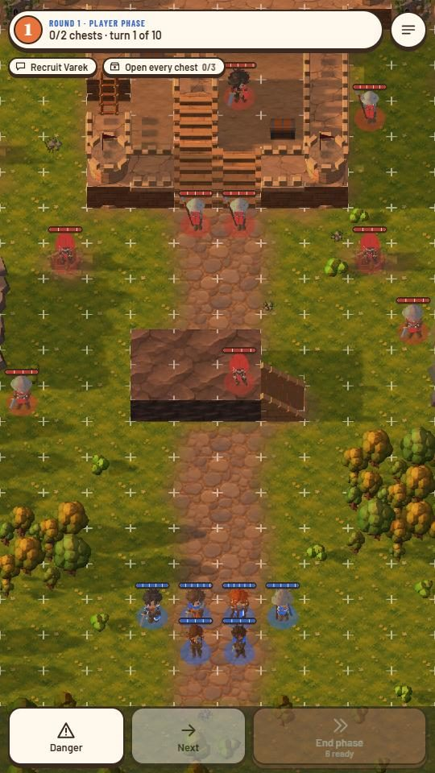 N2 | 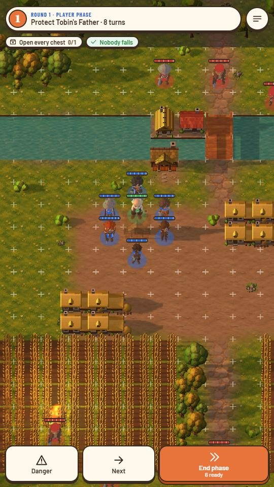 N3 |

Bilder vom Start der Karte, vor der letzten Abstimmung. Ausnahme Prolog: [nach dem Beben](img/p_beben.jpg). Nahaufnahme [Wehrgang 1-6](img/1-6_wehrgang.jpg).

Höhen und Ereignisse je Karte

| Karte | Höhe | Ereignis |
|---|---|---|
| Prolog | kurzes Stück Wehrgang mit Treppe und Schütze, Lektion zur Höhe | Beben Runde 3: Pforte offen, Säulen zu Ruinen |
| 1-1 | Stadtmauer im Norden als Wehrgang zwischen zwei Türmen, Treppen vom Markt | – |
| 1-2 | flach | Miras Haus wie bisher |
| 1-3 | Schrein auf einer Terrasse (Stufe 1) mit Rampe, Ziel `reach` oben | – |
| 1-4 | Fuß 0, Mittelterrasse 1, Oberterrasse mit Höhle 2, Rampen in den Kämmen, Felsnase | Hebel: Felsrutsch verschüttet die Osthöhle, ihre Wellen entfallen |
| 1-5 | Wachhügel auf der Mittelinsel (Stufe 1, zwei Rampen) | – |
| 1-6 | Felder und Terrasse 1 auf 0, ab Stützmauer alles 1, Wehrgänge und Türme 2 | Burgtor geschlossen, Hebel in der Vorburg |
| 1-7 | flach | Beben ab Runde 4, Einsturz der Kammern Runde 5–7 |
| 1-8 | wie 1-6, Tore offen, Ostpforte vermauert | – |
| N1 | Dächer (Stufe 1), sechs Leitern, Dachschützen | – |
| N2 | Turminneres 1, Plattform 2, Grenzhügel als Fels mit Rampe | – |
| N3 | flach | – |

Balance (verkettete Kampagne)

Korridor: Leicht Sieg ≥ 95 %, ≤ 0,5 Niedergestreckte; Normal Sieg ≥ 75 %, 0,4–1,3; Schwer Sieg 30–70 %.

| Karte | Leicht | Normal | Schwer |
|---|---|---|---|
| Prolog | 100 % | 85 % / 0,15 (bewusst sanft) | 38 % |
| 1-1 | 100 % | 100 % / 0,20 | 31–38 % |
| 1-2 | 100 % | 100 % / 0,50 | 55 % |
| 1-3 | 100 % | 100 % / 1,15 | 42 % |
| 1-4 | 100 % | 100 % / 0,75 | 41 % |
| 1-5 | 100 % | 100 % / 1,25 | 52 % |
| 1-6 | 100 % | 100 % / 1,15 | 69 % |
| 1-7 | 100 % | 75 % / 0,45 | 42 % |
| 1-8 | 100 % / **1,05** | 100 % / **1,72** | 63 % |

Leicht und Normal: verkettete Kampagne, 20 Läufe. Schwer: die Zielmission auf Schwer nach einer Kette auf Normal (`pnpm sim <karte> --difficulty hard --chain normal`), weil verkettet auf Schwer kaum ein Lauf bis 1-5 kommt. Die früheren 100 % und 92 % kamen aus ein bis zwei Läufen. Fett = außerhalb.

Noch offen

- 1-7 auf Normal schwankt zwischen 70 und 87 %: Die KI holt die Chronik manchmal nicht in 8 Runden. Das Limit bleibt.
- Prolog und 1-1 auf Normal mit wenig Niedergestreckten (0,15 / 0,20), so gewollt sanft.
- 1-8 auf Leicht und Normal mit zu vielen Niedergestreckten: Die Truppe liegt dort zwei Stufen unter Plan (7,7 statt 9). Weniger Wölfe halfen nicht, darum bleibt die Karte beim Entwurf. Das ist ein Thema der Erfahrungskurve, nicht der Karte.
- Halvard hat noch keine eigene Figur (Platzhalter Dorfältester).
- Häscher in 1-1 heißen als Einheit weiter „Kopfgeldjäger“.
- FPS auf 30 × 40 nicht gemessen; KI-Zug 1-8 höchstens 5 ms je Figur.

