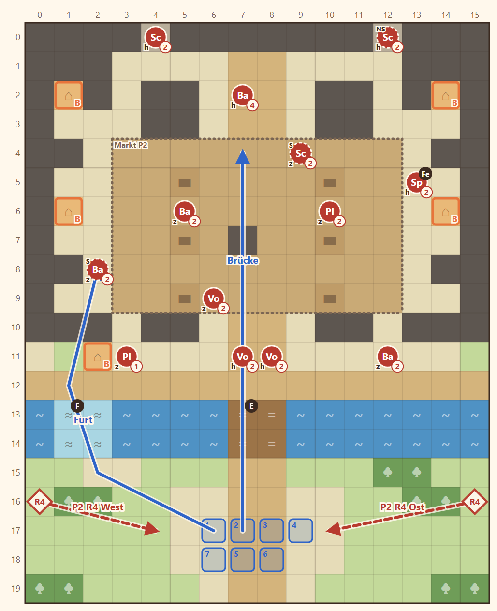

# 1-1 Steckbriefe · Entwurf 1

**Kurz:** K 16×20 · Mittag · alle besiegen · 5 eigene gegen 12 (2,4 : 1)

- Start im Süden. Über die **Brücke** (zwei Lanzen halten sie) oder die **Furt** im Westen (nur zu Fuß, langsam).
- **Markt** mit Ständen als Deckung, Schützen auf zwei **Mauertürmen**, der Anführer vor der Kopfgeldstube.
- **Fenn** reißt am Markt Steckbriefe ab: ansprechen, dann tritt er bei. **Kharesh-Gerücht** im Händlerhaus (B links).
- Runde 4: zwei Häscher aus der Vorstadt fallen der Truppe in den Rücken.

**Im Spiel (2026-11-05):** Stadtmauer als Wehrgang (Stufe 1, x 6–10) mit zwei Türmen (Stufe 2), Treppen vom Markt und vom Wehrgang in die Türme, Rest flach. Abweichungen: Fenn tritt laut Knoten nach dem Sieg bei, nicht auf der Karte (4 statt 5 eigene). Mauer außerhalb des Wehrgangs unbetretbar.

Details

| | |
|---|---|
| Gegner | L 10 · N 12 · S 14, Stufe 1–4 (Anführer St. 4), Waffendreieck gemischt |
| Nebenziele | alle 5 Häuser besuchen · in 12 Runden |
| Phasen | R1–3 Brücke · R4–8 Markt + Rückenwelle · R9–12 Nordviertel |
| Veränderung | keine (nächste veränderliche Karte: 1-4) |
| Datei | `levels/s1_1_1_steckbriefe.yaml` |

