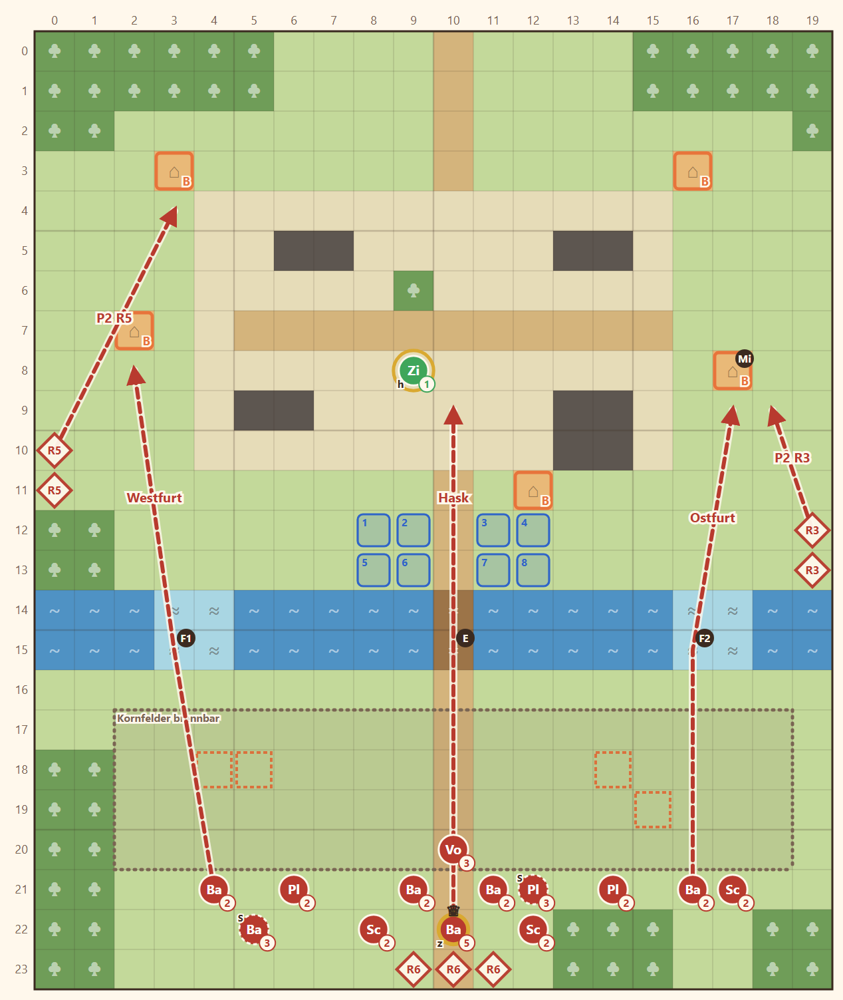

# 1-2 Asche über Erlbach · Entwurf 1

**Kurz:** M 20×24 · Abend, Asche · Dorfältesten 8 Runden schützen · 7 eigene gegen 18 (2,6 : 1) · Leutnant **Hask**

- Der **Bach** ist die Front: die Brücke in der Mitte, zwei **Furten** nur zu Fuß. Die Truppe startet am Nordufer.
- Hask kommt von Süden über die **brennenden Kornfelder**. Ab Runde 3 rückt er selbst vor.
- Plünderer zielen auf die Häuser. Einer geht über die Ostfurt direkt auf **Miras Haus**: Wer es zuerst besucht, bekommt Mira.
- Wellen: Runde 3 Ost, Runde 5 West (beide am Nordufer), Runde 6 Nachschub über die Straße.

Details

| | |
|---|---|
| Gegner | L 15 · N 18 · S 21, Stufe 2–3 plus Hask |
| Aufstellung | 6 (Rhen, Kael, Brenna, Tobin, Fenn + Liora oder ein Söldner), Mira als 7. |
| Nebenziele | Mira gewinnen · alle Häuser besuchen |
| Phasen | R1–2 am Bach · R3–5 Flanken · R6–8 letzter Ansturm |
| Veränderung | nur das Feuer in den Feldern (vorhandene Mechanik) |
| Datei | `levels/s1_1_2_erlbach.yaml` |

