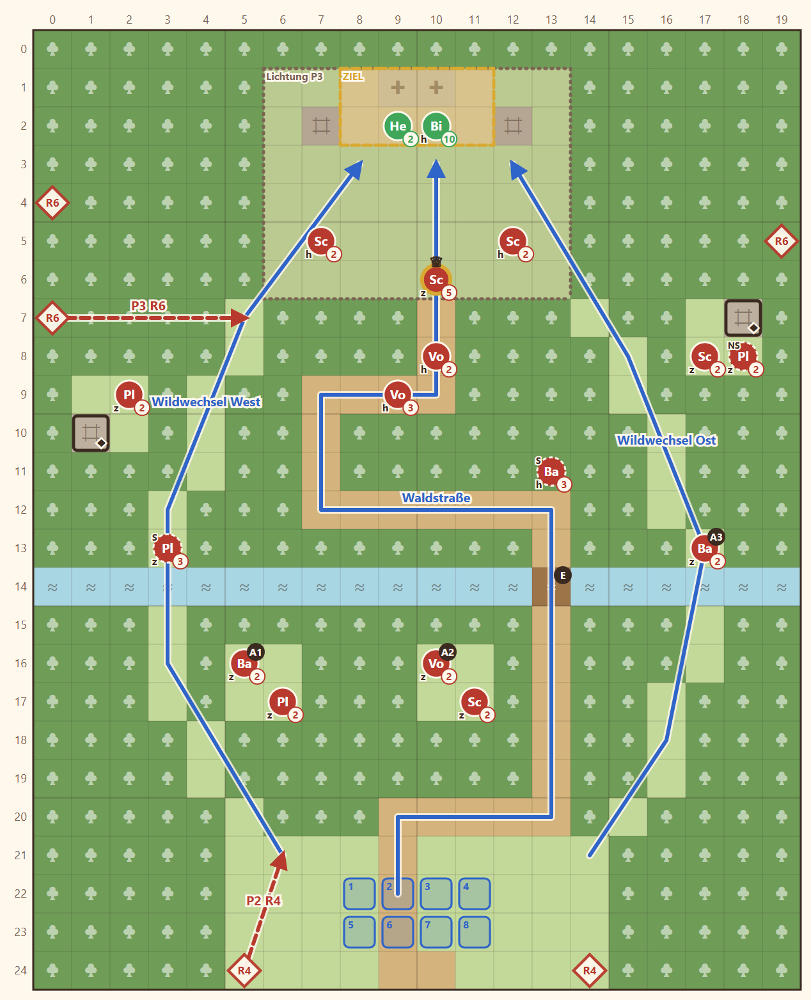

# 1-3 Der Fremde mit dem Siegel · Entwurf 1

**Kurz:** M 20×25 · Morgen, Nebel, **Nebel des Krieges** · Rhen erreicht den Schrein · 7 eigene gegen 18 (2,6 : 1) · Leutnant **Morra**

- Dichter Wald, drei Wege nach Norden: die **Waldstraße** in Schleifen (sicher, lang, Holzsteg am Bach) und zwei **Wildwechsel** West und Ost (kurz, eng).
- **Hinterhalte** in Waldtaschen (A1–A3) wachen erst auf, wenn man nah herankommt. Späher sehen sie früher.
- **Morra** hält mit zwei Schützen den Rand der Lichtung, zwei Lanzen sichern die letzte Kehre der Straße.
- **Halvard** (unangreifbar) und **Liora** warten am Schrein. Liora heilt, wer die Lichtung erreicht, und muss überleben.
- Wellen: Runde 4 von Süden auf der Spur der Truppe, Runde 6 Morras Flankenleute.

**Im Spiel (2026-11-05):** Schrein auf einer Terrasse (Stufe 1, x 6–13, y 1–2), Rampe in der Mitte, zwei Felder breit. Morras Schützen oben in den Ruinen über der Rampe. Abweichungen: Halvard auf dem Schrein mit Platzhalterfigur; Ortsbild bleibt `silberbach`, bis es eines vom Weißdorn gibt; Liora spricht erst auf der Lichtung.

Details

| | |
|---|---|
| Gegner | L 15 · N 18 · S 22, Stufe 2–3 plus Morra |
| Aufstellung | 7 (Rhen, Lucan, Brenna, Tobin, Fenn + Mira oder Söldner) |
| Niederlage | Rhen, Lucan oder Liora fällt |
| Nebenziele | beide Truhen (Ruinen West/Ost) · in 10 Runden |
| Phasen | R1–3 Waldrand · R4–6 Bach · R7–10 Lichtung |
| Veränderung | keine (nächste: 1-4) |
| Datei | `levels/s1_1_3_weissdorn.yaml` |

