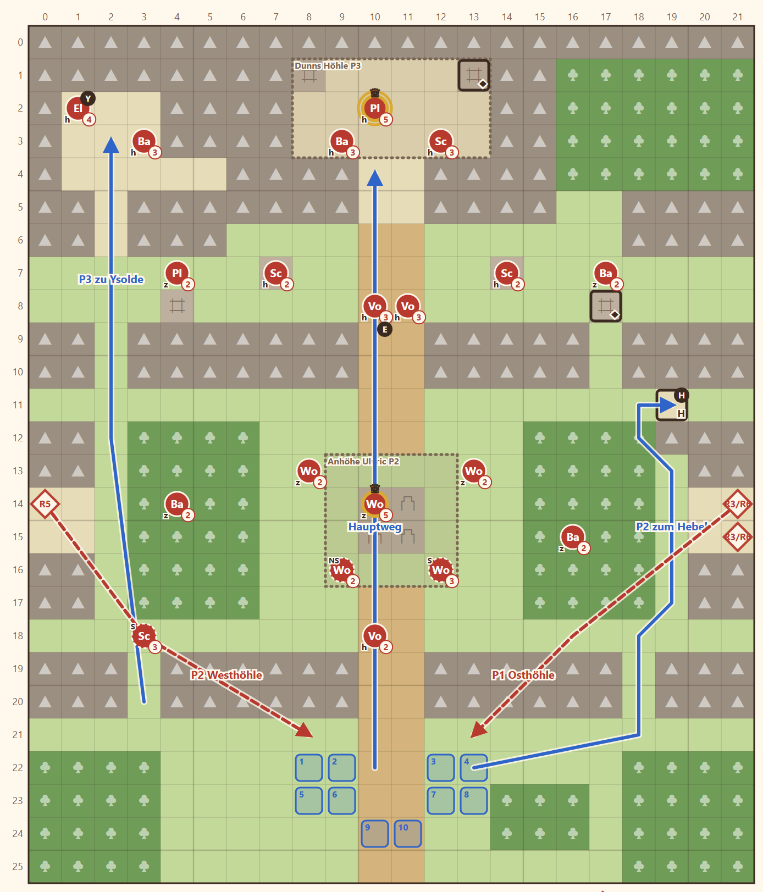

# 1-4 Die Spur des Maklers · Entwurf 1

**Kurz:** M 22×26 · Abend · Boss Osric Dunn · 8 eigene gegen 22 (2,75 : 1) · Leutnant **Ulvric** · **veränderliche Karte**

- Zwei **Felskämme** teilen die Karte in drei Stufen. Durch die Kämme kommt man nur über drei Rampen und eine bewachte Lücke.
- **Ulvric** hält mit Wolfsreitern die Anhöhe in der Mitte. Aus zwei **Wolfshöhlen** kommen Wellen (Runde 3 und 6 Ost, Runde 5 West).
- **Felsrutsch:** Wer den **Hebel** (H) auf der Felsnase erreicht, verschüttet die Osthöhle, danach kommt dort keine Welle mehr.
- **Dunn** sitzt mit zwei Wachen in der Höhle im Norden. Seine **Truhe** öffnet Fenn oder der Schlüssel des Kerkermeisters.
- **Ysolde** sitzt gefangen in der Westhöhle, Rhen spricht sie an.

Details

| | |
|---|---|
| Gegner | L 18 · N 22 · S 26, Stufe 2–3 plus Ulvric, Dunn (St. 5) |
| Aufstellung | 8 (Rhen, Kael, Brenna, Tobin, Fenn, Mira, Liora + 1), Ysolde als 9. |
| Nebenziele | Ysolde gewinnen · beide Truhen |
| Phasen | R1–3 erste Rampe · R4–7 Mittelterrasse + Hebel · R8–12 Dunns Höhle |
| Formatwunsch | `set_terrain`: Der Hebel macht 4 Felder zu Felswand und streicht die Welle in Runde 6 |
| Datei | `levels/s1_1_4_wolfshuegel.yaml` |

