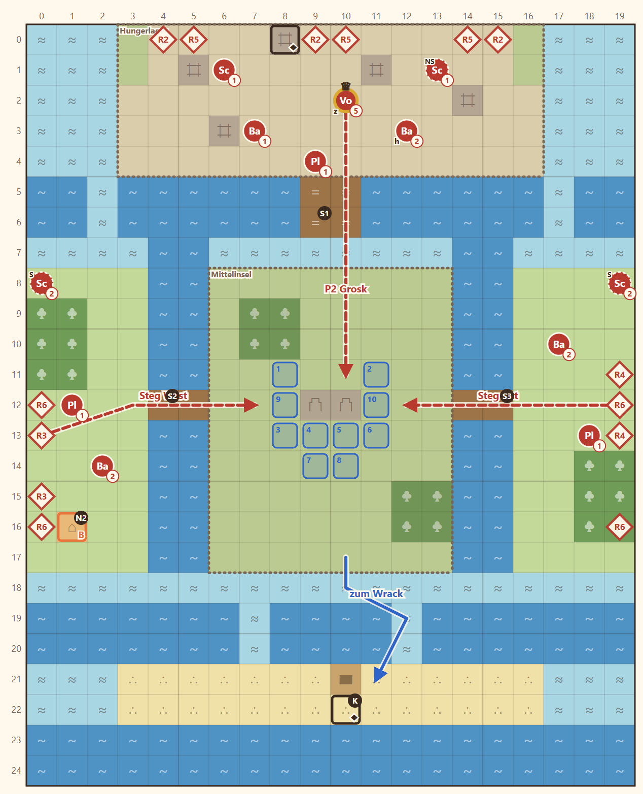

# 1-5 Das Hungerlager · Entwurf 1

**Kurz:** M 20×25 · Morgen, Nebel, **Nebel des Krieges** · 8 Runden überleben · 8 eigene gegen 24 (3 : 1) · Leutnant **Grosk**

- Die Truppe hält die **Mittelinsel** mit dem alten Wachhügel. Ringsum liegen **Priele** (nicht betretbar) und **Sumpf** (langsam, Gepanzerte kommen nicht hinein).
- Drei **Stege** sind die Engstellen: Nord zum Hungerlager, West und Ost zu den Nachbarinseln. Über den Sumpf am Südrand kann man umgehen.
- Viele **schwache Hungernde** (Stufe 1–2) in Wellen jede Runde von Norden, Westen und Osten. **Grosk** rückt ab Runde 4 über den Nordsteg vor, E3 entscheidet, ob er wechselt.
- **Hütte (N2):** Ein alter Hungernder erzählt vom Deserteur am Wachturm. **Schmugglerkiste** im Bootswrack im Süden, den Schlüssel trägt der Vorratsmeister im Lager (oder Fenn öffnet sie).

**Im Spiel seit 2026-11-05:**

- **Höhe:** Wachhügel x 8–11, y 11–13 auf Stufe 1, Rampen West [7,12] und Ost [12,12]. Moor flach.
- **Story:** Varek raus, Hütte kündigt ihn an (`scn.m1_5.watchtower_hint`). Grosk auf dem Brett, E3 unverändert.
- **Abweichungen:** Nordsteg eine Reihe länger, sonst käme der gepanzerte Grosk nie durch den Sumpf; zwei Schlüssel beim Vorratsmeister; eine Figur mehr in Welle R4 (Entwurf listet 23, nennt 24); drei Kinder aus der alten Karte bleiben im Lager; alte Hütten-Szenen entfallen.

Details

| | |
|---|---|
| Gegner | L 19 · N 24 (14 in Wellen R2–R6) · S 27 |
| Nebenziele | beide Truhen · niemand fällt |
| Phasen | R1–3 Nebel · R4–6 Grosk + Wellen von beiden Seiten · R7–8 durchhalten |
| Veränderung | keine (nächste: 1-7 Einsturz) |
| Datei | `levels/s1_1_5_hungerlager.yaml` |

