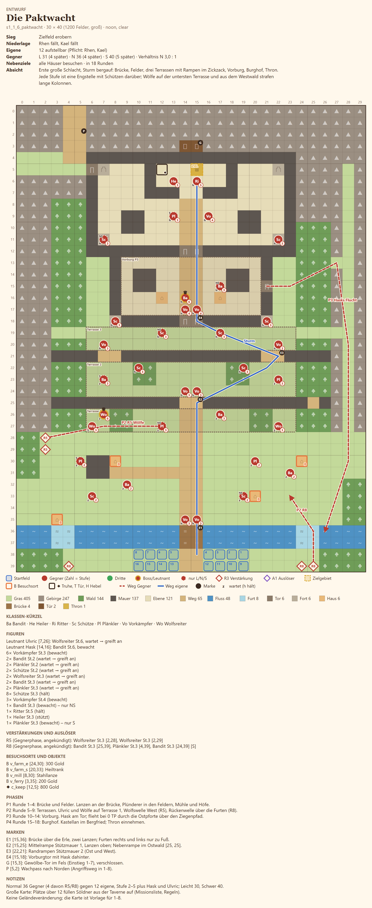

# 1-6 Die Paktwacht · Entwurf 1

**Kurz:** G 30×40 · Mittag · Thron einnehmen · 12 eigene gegen 36 (3 : 1) · Leutnants **Hask** und **Ulvric**

- Sturm **von Süden nach Norden** über sechs Stufen: Brücke über die Erle → Felder mit Mühle und Höfen → **3 Terrassen** → Vorburg → Burghof → Thron im Bergfried.
- Jede Stufe hat eine **Engstelle** mit Schützen darüber: Brücke (Furten rechts und links), Mittelrampe, Randrampen im Zickzack, Vorburgtor, Burgtor.
- **Ulvric** jagt mit Wölfen auf der untersten Terrasse, in Runde 5 kommen weitere Wölfe aus dem Westwald. In Runde 8 setzen Marodeure über die Furten und fallen der Truppe in den Rücken.
- **Hask** hält die Vorburg. Bei 0 TP flieht er durch die Ostpforte über den **Ziegenpfad** nach Süden (den können auch Späher als Flankenweg nutzen).
- Schon sichtbar für später: das **Gewölbe-Tor** im Fels (1-7) und der **Wachpass** im Nordwesten (1-8).

Details

| | |
|---|---|
| Gegner | L 30 · N 36 (4 in Wellen R5/R8) · S 40, Stufe 2–5 plus Hask, Ulvric, Kastellan (Ritter St. 5) |
| Aufstellung | 12, freie Plätze füllen Söldner aus der Taverne |
| Nebenziele | 4 Häuser besuchen (Höfe, Mühle, Fähre) · in 18 Runden |
| Phasen | R1–4 Brücke und Felder · R5–9 Terrassen · R10–14 Vorburg · R15–18 Burghof |
| Veränderung | keine; die Karte ist die Vorlage für 1-8 |
| Datei | `levels/s1_1_6_paktwacht.yaml` |

