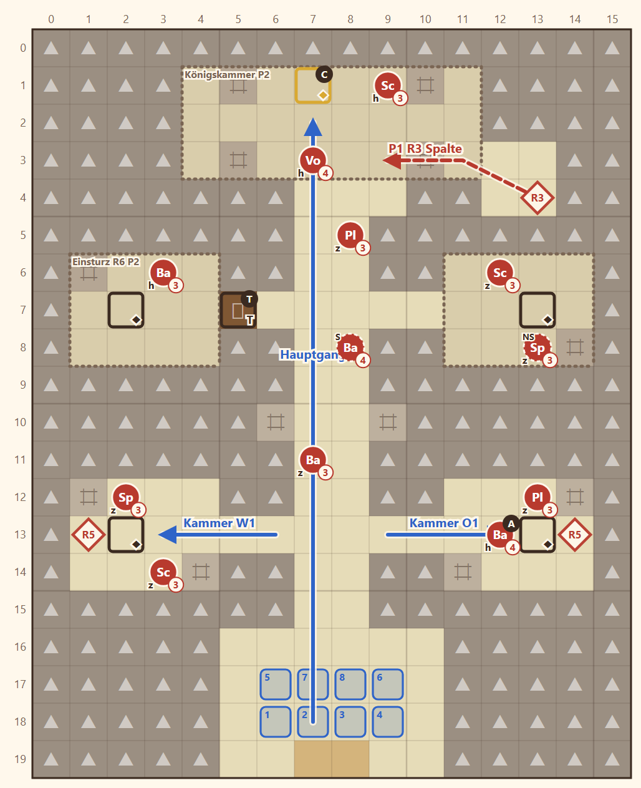

# 1-7 Unter der Paktwacht · Entwurf 1

**Kurz:** K 16×20 · Dunkel, **Nebel des Krieges** · Chronik in 8 Runden öffnen · 6 eigene gegen 14 (2,3 : 1) · **veränderliche Karte**

- Gewölbe im Fels hinter der Burg: Die **Eingangshalle** liegt im Süden, ein **Hauptgang** führt nach Norden, vier **Grabkammern** liegen seitlich, oben die **Königskammer** mit der versiegelten **Chronik**.
- **Einsturz:** Ab Runde 4 bebt es aus dem Norden. In Runde 5 stürzt die Königskammer bis auf die Chronik ein, in Runde 6 die oberen Kammern, in Runde 7 die unteren. Verschüttete Truhen sind verloren.
- Damit stellt sich die Frage: gleich zur Chronik oder erst Beute machen?
- Die **verschlossene Tür** zur Kammer oben links öffnet der Schlüssel des **Anführers** (Kammer unten rechts) oder Fenn.
- Plünderer kommen aus **Felsspalten** (Runde 3 Nordost, Runde 5 aus beiden unteren Kammern).

**Im Spiel (2026-11-05):**

- **Eben,** Einsturz als `set_terrain` zu `rockwall`: Beben Runde 4, Runde 5 Königskammer, 6 obere, 7 untere Kammern. Figuren werden nicht geschoben, ihr Feld bleibt stehen.
- **Abweichungen:** [7,3] und [8,3] bleiben in Runde 5 offen, sonst wäre die Chronik abgeschnitten. Jeder Plünderer trägt einen Schlüssel, damit die Karte ohne Fenn lösbar bleibt. Gegner Stufe 3–6 statt 3–4, Kammern gefährlich, Hauptgang leicht (Korridor). Wetter klar wie im Entwurf, vorher Nebel-Wetter; die Regel Nebel des Krieges bleibt.

Details

| | |
|---|---|
| Gegner | L 11 · N 14 (3 in Wellen R3/R5) · S 15, Stufe 3–4 |
| Nebenziele | alle Truhen · niemand fällt |
| Formatwunsch | `set_terrain`: Felder werden zu Felswand, Figuren darauf rücken aufs nächste freie Feld |
| Story | Grabreliefs zeigen den Pakt (Saat Pakt) |
| Datei | `levels/s1_1_7_gewoelbe.yaml` |

