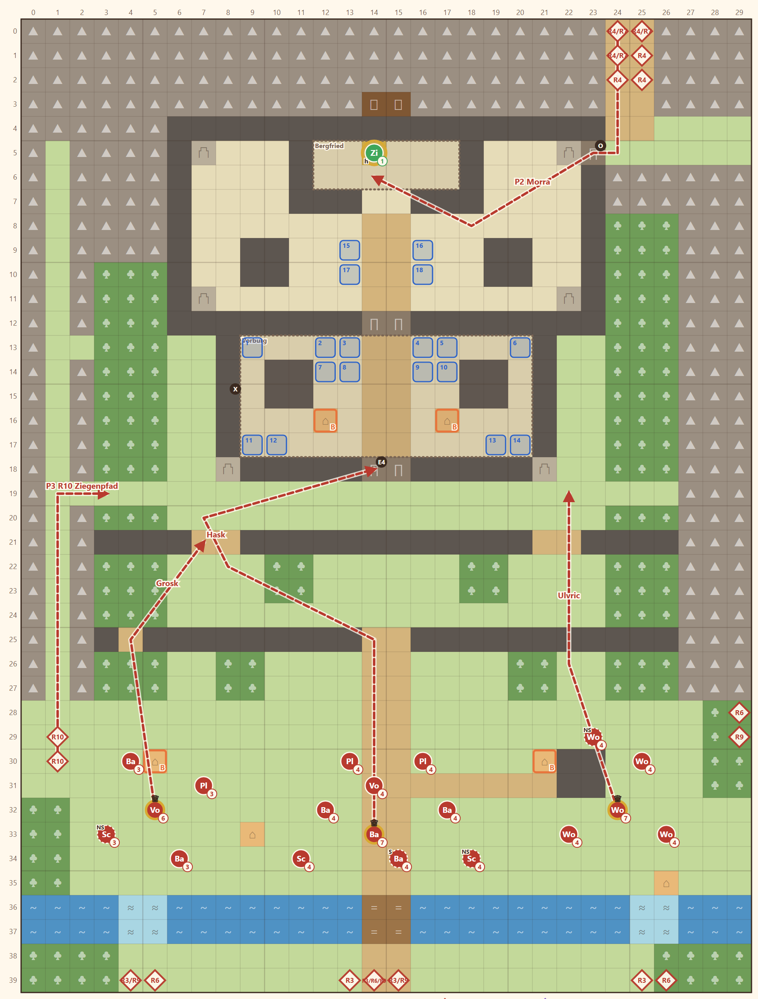

# 1-8 Die Heimat halten · Entwurf 1

**Kurz:** G 30×40 · Abend, Asche · Burgverwalter 12 Runden schützen · 14 eigene gegen 41 (2,9 : 1) · Leutnants **Morra** (führt), **Hask**, **Ulvric**, **Grosk**

- **Gleiche Karte wie 1-6**, nur andersherum: Jetzt hält die Truppe Vorburg, Terrassen und Burghof. Die Westpforte ist vermauert.
- **Von Süden** steigen drei Leutnants die Terrassen hinauf: Hask über die Mitte, Ulvric mit Wölfen von Osten, Grosk von Westen. **Grosk** fehlt samt seinen Leuten, wenn er bei E3 gewechselt ist (dann 36 Gegner).
- **Im Rücken:** Ab Runde 4 kommt **Morra** mit ihren Häschern über den **Wachpass** und greift durch das Osttor den Bergfried an. In Runde 7 folgt Nachschub.
- Die Truppe muss sich **auf zwei Fronten teilen**. Weitere Wellen von Süden in Runde 3, 6 und 9, in Runde 10 ein kleiner Trupp über den Ziegenpfad.

Details

| | |
|---|---|
| Gegner | L 33 · N 41 (24 in Wellen) · S 43, Stufe 3–5 plus vier Leutnants (St. 6–7) |
| Aufstellung | 14 in Vorburg und Burghof, freie Plätze füllen Söldner |
| Nebenziele | 4 Häuser (Hof, Mühle, zwei Ställe) · niemand fällt |
| Phasen | R1–3 Aufmarsch · R4–7 zwei Fronten · R8–12 halten |
| Veränderung | keine (die nächste veränderliche Karte kommt in Akt 2) |
| Datei | `levels/s1_1_8_heimat.yaml` |

