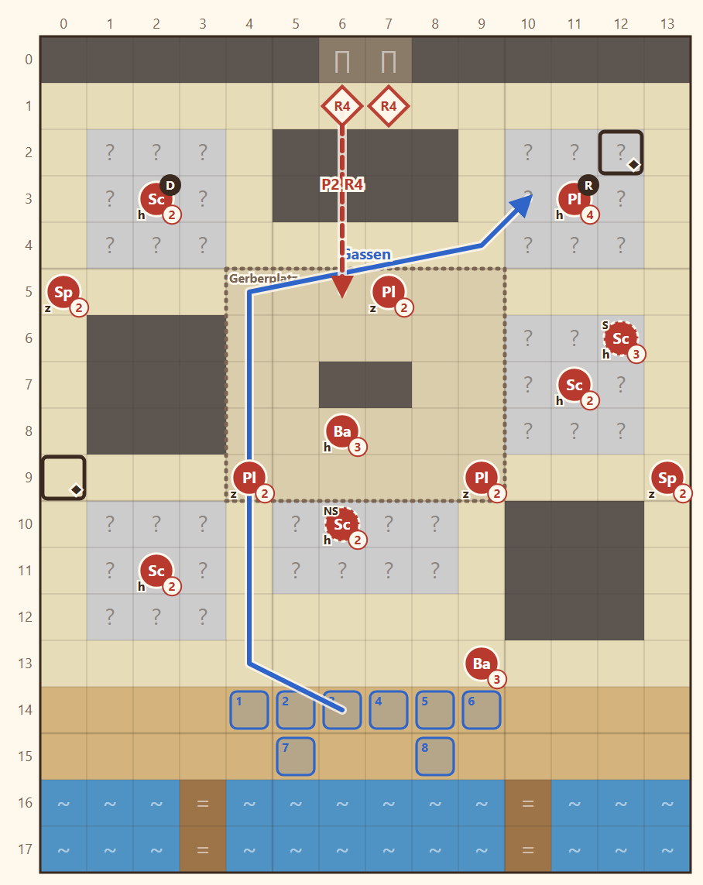

# N1 Der Ring von Varnhold · Entwurf 1

**Kurz:** K 14×18 · Nacht, Nebel, **Nebel des Krieges** · alle besiegen · 6 eigene gegen 14 (2,3 : 1) · Pflicht: Rhen, Fenn

- **Gerberviertel** am Fluss: Gassen im Raster, Häuserblöcke mit begehbaren **Dächern** (graue Felder mit „?“, das Gelände `roof` gibt es noch nicht) und geschlossene Gerberhallen.
- Die Schützen des Rings stehen auf den Dächern, Klingen und Späher warten in den Gassen. Ein Axtträger bewacht den Gerberplatz.
- Der **Ringmeister** sitzt auf dem Dach des Diebesnests (NO) und trägt den **Schlüssel zur Beutetruhe**. Fenn öffnet die Truhe auch ohne.
- Runde 4: zwei Nachzügler durchs Nordtor.

**Im Spiel seit 2026-11-05:**

- **Höhe:** Dächer `roof` Stufe 1, Leitern NW [4,3], NO [9,3] und [11,1], Ost [9,7], SW [4,12], Süd [6,12].
- **Gedenken:** Fenn gefallen: Karte gleich, Aufstellung ohne ihn, seine Niederlage entfällt, Zielblatt nennt ihn nicht. Zwei Schlüssel beim Ringmeister, je Truhe einer.
- **Abweichungen:** Gerberhallen als Häuser (`building`) statt Mauer, Bottiche als `well`, damit sie nicht begehbar wirken (sperren die Sicht im Nebel dadurch nicht mehr). Niederlage auch bei Kaels Tod, falls er mitkommt. Späher mit Dolch statt Schwert.

Details

| | |
|---|---|
| Gegner | L 12 · N 14 · S 15, Stufe 2–4 |
| Nebenziele | beide Truhen · in 9 Runden |
| Neues Gelände | `roof`: nur zu Fuß, Kosten 2, Ausweichen +20 |
| Veränderung | keine |
| Datei | `levels/s1_n1_ring.yaml` |

