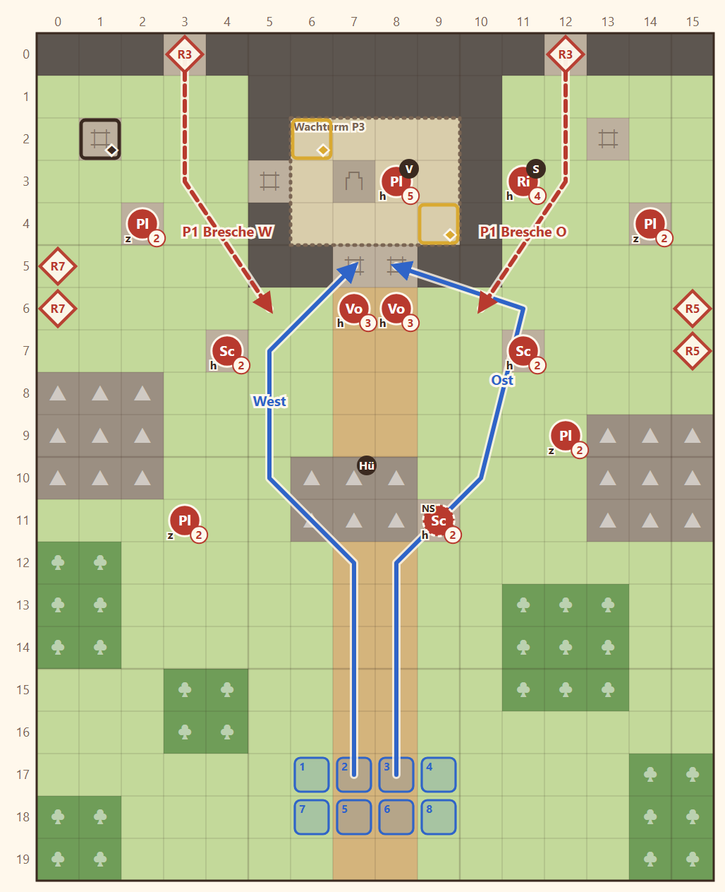

# N2 Der letzte Wachturm · Entwurf 1

**Kurz:** K 16×20 · Abend · 2 Truhen im Turm in 10 Runden öffnen · 6 eigene gegen 15 (2,5 : 1) · **Beitritt Varek**

- **Turmruine** an der Grenzmauer, dahinter liegt Kharesh. Ein **Suchtrupp des Grenzheers** belagert den Turm: zwei Lanzen am Eingang, Schützen auf den Mauerresten.
- Der **Grenzhügel** in der Mitte teilt den Anmarsch in West und Ost.
- **Varek** ist im Turm verschanzt. Nur **Kael** kann ihn ansprechen, sonst bleibt er allein zurück.
- Truhen: **Chronik-Seite** und **Schild der Paktwächter**. Die Schildtruhe ist verschlossen, den Schlüssel trägt der **Feldwebel** (oder Fenn öffnet sie). Dazu ein Versteck im Westen.
- Wellen: Runde 3 durch zwei **Breschen** in der Mauer, Runde 5 von Osten, Runde 7 von Westen.

**Im Spiel seit 2026-11-05:**

- **Höhe:** Turminneres Stufe 1, Plattform [7,3] Stufe 2 über Treppe [7,4]. Zugang Treppe Süd [7,5]/[8,5], Leiter Westbresche [5,3]. Grenzhügel Fels Stufe 1, Rampe Ost [9,11], Schütze oben.
- **Story:** Varek tritt hier bei (`scn.n2.varek_talk`), Sichtungszeile `scn.n2.varek_spotted`. Kael erzählt vom Grenzkrieg.
- **Abweichungen:** Truhen heißen `c_page`, `c_relic`; Relikt `pact_warden_shield`. Drei Schlüssel: je einer bei den zwei Lanzen und beim Feldwebel. Lanzen rücken vor (Radius 4), statt die Treppe zu sperren. Varek greift nicht an, bis Kael ihn anspricht.

Details

| | |
|---|---|
| Gegner | L 12 · N 15 · S 17, Stufe 2–4 (Feldwebel Ritter St. 4) |
| Nebenziele | Varek gewinnen · Versteck-Truhe |
| Offen | Item `pactwarden_shield` fehlt noch in `items.yaml` |
| Veränderung | keine (nächste: 1-7) |
| Datei | `levels/s1_n2_wachturm.yaml` |

