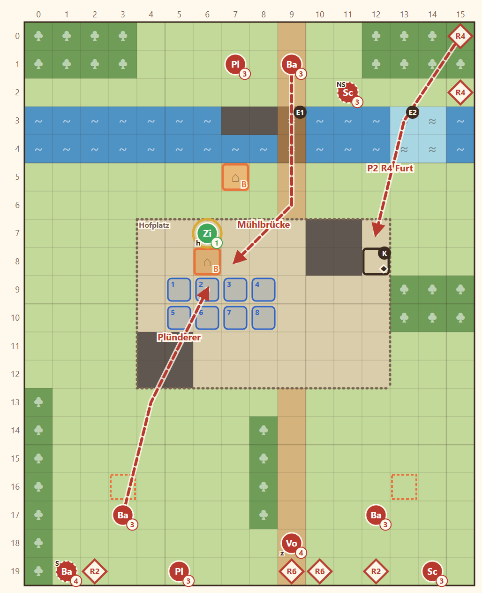

# N3 Das Erbe · Entwurf 1

**Kurz:** K 16×20 · Abend · Tobins Vater 8 Runden schützen · 6 eigene gegen 14 (2,3 : 1) · Pflicht: Rhen, Tobin

- **Pachthof** in der Mitte: das Wohnhaus, daneben der Vater, zwei Scheunen. Im Norden fließt der Fluss mit der **Mühle**, der **Mühlbrücke** (E1) und einer **Furt** (E2).
- **Zwei Fronten:** Hasks versprengte Marodeure kommen von Süden über die **brennenden Kornfelder** und von Norden über die Brücke. In Runde 4 setzt eine Welle über die Furt.
- Plünderer zielen auf **Wohnhaus** und **Müllerhaus**.
- **Truhe** in der Scheune: Den Schlüssel trägt der **Hauptmann** (rückt ab Runde 2 vor), Fenn öffnet sie auch ohne.
- Nach dem Sieg übergibt der Vater Tobins **Signaturlanze** (Szene).

Details

| | |
|---|---|
| Gegner | L 11 · N 14 (6 in Wellen R2/R4/R6) · S 16, Stufe 3–4 |
| Nebenziele | Scheunentruhe · niemand fällt |
| Veränderung | nur das Feuer in den Feldern; nächste veränderliche Karte: 1-7 Einsturz |
| Datei | `levels/s1_n3_erbe.yaml` |

