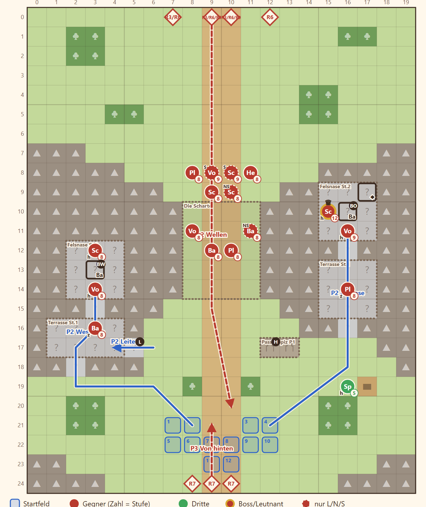

# 2-1 Wind über der Eisenmark · Entwurf 1

**Kurz:** M 20×25 · Morgen · 10 Runden überstehen · 9 eigene gegen 24 (2,7 : 1) · Leutnant **Brakka** · Beitritt **Jory**

- Die Truppe kommt von Süden. Die **Windscharte** ist vier Felder breit, darüber zwei **Felsnasen mit Ballisten**.
- **Balliste:** Wer oben steht, dreht sie um. Hinauf geht es über Rampe und Treppe, im Westen auch über eine Leiter (nur zu Fuß).
- **Söldnerwellen** kommen in Runde 3, 6 und 9 über die Ebene. In Runde 7 kommen **Söldner von hinten**.
- **Jory** steckt am Gauklerwagen fest, in Reichweite der Ostballiste. Das **Passhospiz** heilt, liegt aber ebenfalls im Schussfeld.
- Runde 8 **Drachenschatten**, nach Runde 10 bieten Seraphine und Dravn den Freispruch an.

Details

| | |
|---|---|
| Gegner | L 20 · N 24 · S 28, Stufe P−3 bis P−1 (hier 8–10), Leutnants P+1 bis P+2 |
| Aufstellung | 9 von 12 Feldern, Pflicht Rhen und Lucan |
| Nebenziele | Jory anwerben · Brakkas Soldtruhe auf der Ostnase |
| Phasen | R1–3 Kessel · R4–6 Wellen und Sturm auf die Nasen · R7–10 Falle |
| Formatwünsche | Regel Balliste (fehlt in `src/core`), Leutnant `brakka` |
| Datei | `levels/s2_2_1_windscharte.yaml` |

**Korrektur Story 11.10 (2026-11-07):** Beide Ballisten stehen jetzt auf dem Gelände `ballista` (Regel aus Story 11.6), auf Stufe 2 wie die Felsnase. Jory ist Gast (`guest: true`): Er tritt nur bei, wenn man ihn anspricht.

## Übernahme Story 11.12 (2026-11-09)

Ins Spiel übernommen als `content/acts/act2/maps/m2_1_windscharte.yaml` (Knoten `m2_1`, Akt 2 unveröffentlicht, sichtbar mit `pnpm dev:act2`). Gelände, Stufen, Leiter, Ballisten, Truhe, Aufstellung, Wellen und Ziele wie im Entwurf.

**Sim [C]** (`pnpm sim --campaign act2 --start expected --runs 50`, P = 12, 9 eigene):

| Stufe | Sieg | Niedergestreckte | Tote | Korridor |
|---|---|---|---|---|
| Leicht | 86 % | 1,36 | 0,96 | Sieg und Niedergestreckte außerhalb (≥ 95 %, ≤ 0,5) |
| Normal | 78 % | 4,64 | 1,65 | Sieg im Korridor, Niedergestreckte außerhalb (0,4–1,3) |
| Schwer | 70 % | 8,12 | 3,31 | im Korridor (30–70 %) |

Verkettet nach Akt 1 (`pnpm sim --campaign act2 --runs 50`, Normal): 46 von 50 Läufen erreichen 2-1, Sieg 87 %, 1,63 Niedergestreckte, 0,54 Tote, im Schnitt 4,9 eingesetzt. Gold 1 100 + 200 (Jory) liegt unter der Goldkurve von Akt 2 (2 000–3 000). Erkundet (je 50 Läufe, Normal): ohne Ballisten 100 % / 2,40; Wellen auf P−3 78 % / 4,64; Westballiste ohne Bedienung 100 % / 5,28; zwei Startgegner weniger 88 % / 4,80. Die Ballisten tragen den größten Teil der Niedergestreckten; Abstimmung offen (PO-Frage, Story 11.27).

Abweichungen vom Entwurf

| Entwurf | Spiel | Grund |
|---|---|---|
| `id: s2_2_1_windscharte` | `m2_1_windscharte` | Karten-Id des Knotens (11.3/11.11) |
| `scn.s2_1.*` | `scn.m2_1.*` | Szenen-Schema `scn.<knoten>.*` |
| Lektion `turn_start` R1 | `scn.m2_1.tutorial_ballista` per `unit_enters` auf eine Felsnase oder ihre Treppe | PO 2026-11-09 (F3 = A), Szene aus 11.6 |
| `t_riders` / `riders_lesson` | entfällt | keine Reiter (GDD-Log 2026-11-05) |
| `unit.mercenary.name` | `unit.free_blade.name`, Figuren des Pools `free_blades` | Schlüssel fehlte; Fraktion Freie Klingen |
| `level` + `levelOffset` | nur `levelOffset` | Story 11.2 |
| Plänkler der Wellen mit `iron_lance` | `iron_sword` | Klasse skirmisher führt keine Lanze |
| Brakka Stufe 12 | Stufe nach der Leutnant-Regel, `steel_bow` bleibt (Signatur `wasp_sting` ist Beute, nie Kartenwaffe) | 11.5 |
| Jory Stufe 5, `iron_dagger` | Gefährten-Definition: max(10, P − 1) = 11, `steel_dagger`, `travel_lute`, `vulnerary` | 11.5, 11.2 |
| Nachszene „Boten“ | Lanzenreiter der Prinzessin ohne Rowena + Bote des Grenzheers; Rhen antwortet mit Haltung (Folgen-Karte, kein Flag) | PO 2026-11-09 (F1 = B, F2 = A) |
| Höhen | unverändert: crag ist Stufe 2, die Nachbarfelder der Ballisten taugen zum Bedienen | Test `m2-1-windscharte.test.ts` |

Ohne Heimsuchungs-Anker (der Entwurf hat keine).

