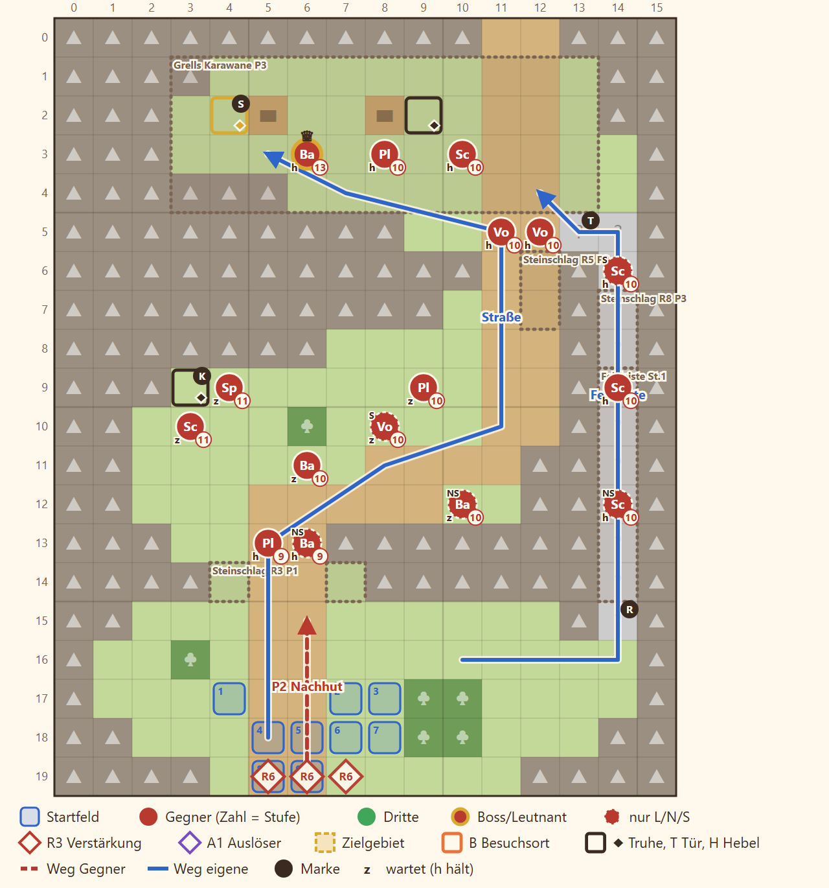

# 2-2 Das Siegel im Salzpass · Entwurf 1

**Kurz:** K 16×20 · Nebel · Truhe binnen 11 Runden öffnen · 7 eigene gegen 16 (2,3 : 1) · Leutnant **Grell** · **veränderliche Karte**

- Enger Pass mit drei Kammern. Die **Straße** ist sicher, aber lang, die schmale **Felsleiste** im Osten ist kurz, aber von Schützen besetzt.
- **Steinschlag:** Runde 3 engt die Südenge ein, Runde 5 die Nordenge auf ein Feld, Runde 8 sperrt die Leiste. Die Straße bleibt immer offen.
- **Nebel:** Man sieht nur, was die eigenen Figuren sehen. Fenn sieht weiter und öffnet die Siegeltruhe ohne Schlüssel, sonst trägt ihn Grells Zahlmeister.
- **Kundschafter aus Kharesh** warten im Westwinkel, ihre Truhe trägt die Saat. In Runde 6 schließt Grells Nachhut von Süden auf.

Details

| | |
|---|---|
| Gegner | L 13 · N 16 · S 19, Stufe P−3 bis P−1 (hier 9–11), Leutnants P+1 bis P+2 |
| Aufstellung | 7 von 9 Feldern, Pflicht Rhen und Kael |
| Nebenziele | alle drei Truhen (eine mit Chronik-Seite) |
| Phasen | R1–3 Südenge · R4–7 Mittelkammer · R8–11 Karawane |
| Formatwünsche | Gegenstand Siegel, Chronik-Seite, Leutnant `grell` |
| Datei | `levels/s2_2_2_salzpass.yaml` |

