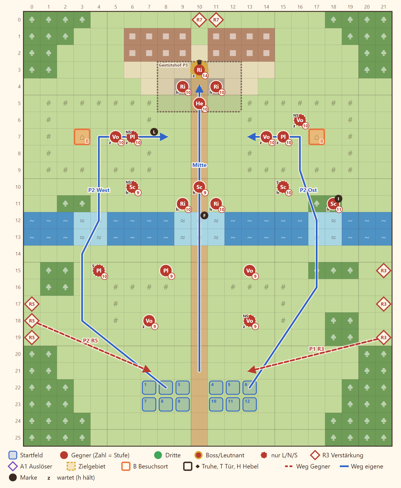

# 2-3 Die Rabenweide · Entwurf 1

**Kurz:** M 22×26 · Mittag · Boss Rowena · 9 eigene gegen 24 (2,7 : 1) · Beitritt **Ilka**

- Die Truppe kommt im Süden über **offene Weiden**. Dort gibt es keine Deckung, Rücken und Flanken sind offen (Runde 3 von Osten, Runde 5 von Westen).
- Die **Aure** hat drei Furten und keine Brücke. Die Furten kosten Bewegung und sind die Engstellen.
- Nördlich liegen die **Koppeln**: Zäune sperren alle Figuren, die Lücken sind Engstellen für Vorkämpfer. Lanzen warten darin, bis jemand nah kommt; die Pferde sind nur Kulisse.
- **Rowena** kämpft zu Fuß und hält den Gestütshof mit Rittern und gibt nach ihrer Niederlage auf. Sie lässt einen verwundeten Gefährten versorgen.
- **Ilka** steht im Wald am Nordostufer. Wer sie anspricht, gewinnt sie.

Details

| | |
|---|---|
| Gegner | L 20 · N 24 · S 28, Stufe P−3 bis P−1 (hier 9–11), Leutnants P+1 bis P+2 |
| Aufstellung | 9 von 12 Feldern, Pflicht Rhen und Kael |
| Nebenziele | Ilka gewinnen · beide Ställe besuchen |
| Phasen | R1–4 Weide · R5–7 Furten · R8–12 Gestütshof |
| Formatwünsche | Leutnant `rowena`, Modelle Koppel, Stall, Gestüt |
| Datei | `levels/s2_2_3_rabenweide.yaml` |

