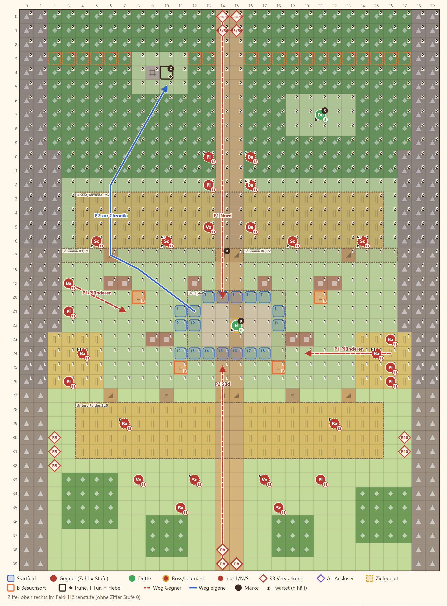

# 2-4 Die Brandschneise · Entwurf 1

**Kurz:** G 30×40 · Abend, Asche · Brann 12 Runden verteidigen · 12 eigene gegen 38 (3,2 : 1) · Leutnant **Grell** · Sable sieht zu · **veränderliche Karte**

- **Drei Stufen:** oben Wald und Getreide, in der Mitte das Dorf, unten Felder. Durch die Kanten kommt man nur über Rampen und Treppen, Schützen oben schießen weiter.
- **Feuer** frisst sich von Norden durch den Wald. **Brann** steht auf dem Schrein und reißt in Runde 3 und 6 die Schneise auf, die das Dorf rettet.
- **Plünderer** in den Flanken gehen auf die Häuser, nicht auf die Truppe. Wer sie schützen will, muss sich teilen.
- **Grell** kommt in Runde 6 über das Verbrannte, weitere Wellen von Süden, Westen und Osten.
- **Sable** steht als Dravns Offizierin auf einer Lichtung und greift nicht ein (danach E7).

Details

| | |
|---|---|
| Gegner | L 33 · N 38 · S 44, Stufe P−3 bis P−1 (hier 11–13), Leutnants P+1 bis P+2 |
| Aufstellung | 12 von 18 Feldern im Dorf, Pflicht Rhen und Lucan, Brann als Gast |
| Niederlage | Rhen, Lucan oder Brann fallen |
| Nebenziele | alle 4 Häuser besuchen · Chronik-Seite in der Köhlerruine |
| Phasen | R1–4 Brand · R5–8 Häuser halten · R9–12 Durchhalten |
| Formatwünsche | Leutnant `grell`, Modelle Getreideterrasse und Stützmauer |
| Datei | `levels/s2_2_4_brandschneise.yaml` |

**Korrektur Story 11.10 (2026-11-07):** Brann ist Gast (`guest: true`): nicht steuerbar, Schutzziel, tritt nach der Mission nicht bei (das geschieht in N5). Wetter Asche ist jetzt auch in Akt 2 erlaubt (`render.yaml`).
