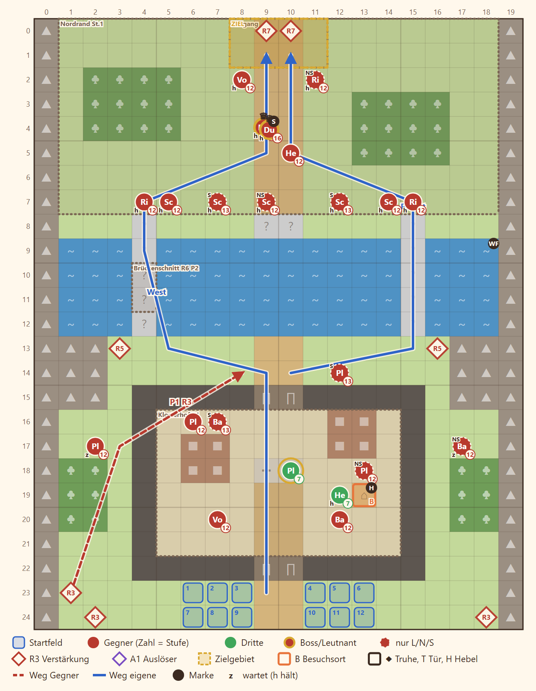

# 2-5 Die verstoßene Leibwache · Entwurf 1

**Kurz:** M 20×25 · Mittag · Odile zum Ausgang bringen · 9 eigene gegen 22 (2,4 : 1) · Leutnant **Sable** · Beitritt **Odile**, **Amos** · **veränderliche Karte**

- Die Truppe stürmt von Süden den **Klosterhof**, Odile folgt dann der nächsten eigenen Figur. Der Ausgang liegt jenseits der Schlucht.
- **Zwei Hängebrücken** führen über die Schlucht. In Runde 6 kappen Sables Leute die **Westbrücke**, eine Runde vorher kommt die Warnung.
- Der **Nordrand** liegt eine Stufe höher: Schützen schießen weiter, Ritter halten die Rampen.
- **Sable** hält den Ausgang. Hat sie bei E7 gewechselt, steht dort ein Hauptmann des Grenzheers mit gleichen Werten.
- **Amos** ist im Hospiz, wer ihn anspricht, gewinnt ihn.

Details

| | |
|---|---|
| Gegner | L 18 · N 22 · S 26, Stufe P−3 bis P−1 (hier 12–14), Leutnants P+1 bis P+2; das Blatt zählt Sable und Hauptmann beide |
| Aufstellung | 9 von 12 Feldern, Pflicht Rhen und Lucan |
| Niederlage | Rhen, Lucan oder Odile fallen |
| Nebenziele | Amos gewinnen · binnen 11 Runden |
| Phasen | R1–3 Klosterhof · R4–7 Brücken · R8–12 Ausgang |
| Formatwünsche | Modelle Hängebrücke und Wasserfall, Flags für E7 |
| Datei | `levels/s2_2_5_silberquell.yaml` |

**Korrektur Story 11.10 (2026-11-07):** Der Hauptmann ist kein Leutnant mehr (`lieutenant: sable` entfernt, sonst wäre er Sable); Sable darf als Leutnant `requires` tragen. Das Kappen der Westbrücke trägt `warn: true` (Warnung ab Runde 5). Amos ist Gast. Flags `e7_order`/`e7_warned` im Paket `act2` (Platzhalter bis 11.5).

**Nachtrag Review 11.10:** Genau eine Figur hält die Stelle: der Hauptmann mit `e7_warned`, sonst Sable (`requires: [{ not: { flag: e7_warned } }]`), auch ohne E7 und wenn beide Flags gesetzt wären.

## Übernahme Story 11.16 (2026-11-09)

Ins Spiel übernommen als `content/acts/act2/maps/m2_5_silberquell.yaml` (Knoten `m2_5`, Ort `silberquell`, Akt 2 unveröffentlicht, sichtbar mit `pnpm dev:act2`, Lab `silberquell-2-5` bzw. `silberquell-2-5-warn`). Gelände, Stufen, Hospiz, Aufstellung, Wellen, Ziele und der Brückenschnitt wie im Entwurf.

**Sim [C]** (`pnpm sim m2_5_silberquell --campaign act2 --start expected --runs 50`, Normal; 2-2 bis 2-4 noch ohne Karte, deshalb Armee-Stufe 14,7 statt der erwarteten 16):

| Stufe | Sieg | Runden p10/p50/p90 | Niedergestreckte | Tote | Gold |
|---|---|---|---|---|---|
| Normal | 100 % | 12 / 15 / 22 | 0,86 | 0,14 | 2 000 + 312 Nebenziele |

Amos wird immer gewonnen, „binnen 11 Runden“ nur in 4 %: Die KI führt Odile langsam (Profil `follow`), im Schnitt 16 Runden. Abstimmung in Story 11.27.

**Abweichungen vom Entwurf:**

| Entwurf | Spiel | Grund |
|---|---|---|
| `id: s2_2_5_silberquell`, `scn.s2_5.*` | `m2_5_silberquell`, `scn.m2_5.*` | Karten-Id des Knotens, Szenen-Schema |
| `level` + `levelOffset` | nur `levelOffset`, Figuren des Grenzheer-Pools (`sprite`) | Story 11.2, 11.7 |
| Odile, Amos Stufe 7 mit eigenen Waffen | Werte der Gefährten (`units.yaml`), Stufe P − 1 | Story 11.5, wie Jory in 2-1 |
| Hauptmann „gleiche Werte“ wie Sable | `levelOffset: 1` (P + 1), Sables Stufe kommt aus der Leutnant-Regel | Der Hauptmann ist kein Leutnant (Korrektur 11.10) |
| `goldReward: 1200` | 2 000 | Goldkurve von Akt 2, wie 2-1 [ASSUMPTION] |
| keine Heimsuchungs-Anker | `escort` (Klosterhof → Ausgang), `rout` (Nordrand) | Muster 2-1 [ASSUMPTION] |
| — | Trigger `t_odile` → `scn.m2_5.odile_meet` | Begegnung mit Odile vor dem Beitritt [ASSUMPTION] |
| `join: true` am Sieg | weggelassen | Beitritt ist Standard (Story 4.8) |
| Treppe `[9,8]`/`[10,8]` | bleibt, Kulisse ohne Brücke | im Entwurf ohne Gegenstück, stört die Wege nicht |
| Modelle Hängebrücke, Wasserfall | `footbridge` (Steg), Wasserfall als Fluss | Modelle fehlen (Matrix), nicht Teil der Story |
