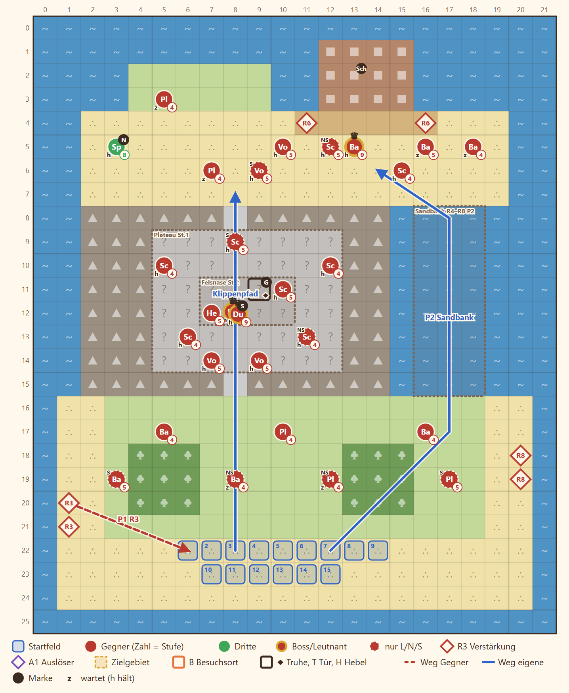

# 2-6 Gold für Banditen · Entwurf 1

**Kurz:** M 22×26 · Abend · alle besiegen · 10 eigene gegen 28 (2,8 : 1) · Leutnants **Grell**, **Sable** · Beitritt **Nell** · **veränderliche Karte**

- **Krähenholm:** Landung am Südstrand, in der Mitte ein Klippenrücken, im Norden die Bucht mit Grells Schiff.
- **Zwei Wege** nach Norden: der bewachte **Klippenpfad** über Plateau und Felsnase oder die **Sandbank** im Osten.
- **Ebbe und Flut:** Die Sandbank liegt nur von Runde 4 bis 8 frei, in Runde 9 ist sie wieder Wasser. Davor kommt eine Warnung.
- **Sable** übergibt auf der Felsnase Dravns Gold, die Truhe ist das Beweisstück. Hat sie bei E7 gewechselt, steht dort ein Hauptmann und sie belastet Dravn in einer Szene.
- **Nell** versteckt sich im Nordwesten, wer sie anspricht, gewinnt sie.

Details

| | |
|---|---|
| Gegner | L 24 · N 28 · S 32, Stufe 4–5 plus Grell, Sable (St. 9); das Blatt zählt Sable und Hauptmann beide |
| Aufstellung | 10 von 15 Feldern, Pflicht Rhen und Kael |
| Nebenziele | Nell gewinnen · Dravns Gold bergen |
| Phasen | R1–3 Landung · R4–8 Ebbe · R9–14 Flut |
| Formatwünsche | Modelle Schiff, Boot, Kai, Flags für E7 |
| Datei | `levels/s2_2_6_kraehenholm.yaml` |

