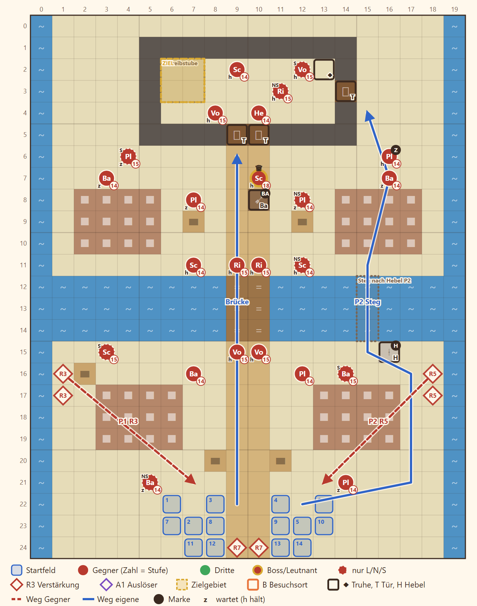

# 2-7 Das Kontor am Silbermeer · Entwurf 1

**Kurz:** M 20×25 · Regen · Schreibstube erreichen · 10 eigene gegen 26 (2,6 : 1) · Leutnant **Brakka** · **veränderliche Karte**

- Ein **Hafenbecken** teilt die Karte, nur eine Steinbrücke führt hinüber, und **Brakkas Balliste** hält sie unter Feuer.
- **Hebel am Kran** im Osten: Er legt einen **Steg** über das Becken und öffnet den Weg zur Ostseite.
- Das **Kontor** hat zwei verschlossene Eingänge. Den Schlüssel trägt der **Zahlmeister** an der Ostseite, Fenn braucht keinen.
- Eine Figur in der **Schreibstube** genügt, die Chronik-Seite liegt in der Nordostecke desselben Raums.
- Wellen in Runde 3, 5 und 7 von den Kais und von hinten.

Details

| | |
|---|---|
| Gegner | L 22 · N 26 · S 30, Stufe P−3 bis P−1 (hier 14–16), Leutnants P+1 bis P+2 |
| Aufstellung | 10 von 14 Feldern, Pflicht Rhen und Lucan |
| Nebenziele | Chronik-Seite · binnen 12 Runden |
| Phasen | R1–4 Südkai · R5–8 über das Becken · R9–13 Kontor |
| Formatwünsche | Modelle Kai, Lagerhaus, Kran, Schiff, Regel Balliste |
| Datei | `levels/s2_2_7_kontor.yaml` |

**Korrektur Story 11.10 (2026-11-07):** Die Balliste am Kai steht jetzt auf dem Gelände `ballista`.
