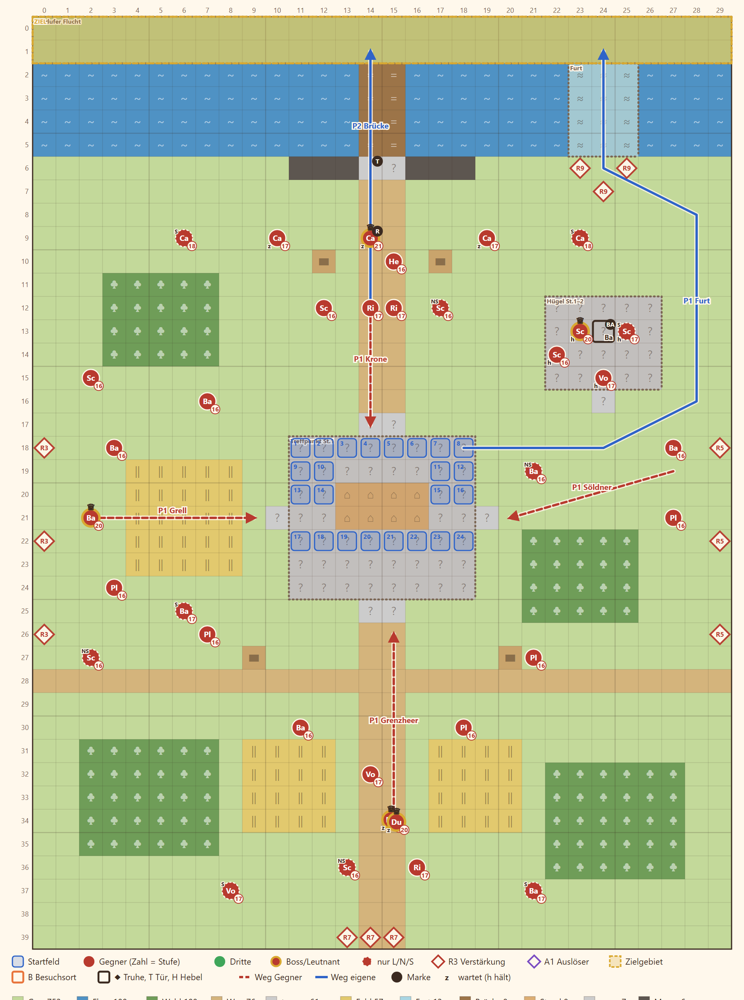

# 2-8 Kronfeld · Entwurf 1

**Kurz:** G 30×40 · Abend · 6 Figuren aufs Nordufer retten · 15 eigene gegen 40 (2,7 : 1) · Leutnants **Rowena**, **Grell**, **Brakka**, **Sable** · **veränderliche Karte**

- Der **neutrale Treffpunkt** ist die Falle: Die Truppe steht auf dem Hügel in der Mitte, die vier Mächte kommen von allen Seiten.
- **Überleben, dann ausbrechen:** Das Brückentor ist zu. In **Runde 6 zögert Rowena**, das Tor geht auf, und ihre Leute halten still.
- Wer früher weg will, muss zur **Furt** im Osten. Sie ist weit und wird ab Runde 9 von Lanzen gesperrt.
- **Brakkas Balliste** steht auf dem Osthügel und reicht bis zum Treffpunkt. Wellen kommen in Runde 3 und 5 über die Ebene.
- Hat Sable bei E7 gewechselt, führt im Süden der Hauptmann.

Details

| | |
|---|---|
| Gegner | L 36 · N 40 · S 46, Stufe P−3 bis P−1 (hier 16–18), Leutnants P+1 bis P+2; das Blatt zählt Sable und Hauptmann beide |
| Aufstellung | 15 von 24 Feldern, Pflicht Rhen und Lucan |
| Sieg | 6 Figuren aufs Nordufer (Vorschlag, per `pnpm sim` prüfen) |
| Nebenziele | niemand fällt · binnen 14 Runden |
| Phasen | R1–5 überleben · R6–9 das Tor · R10–15 Ausbruch |
| Formatwünsche | Regel Balliste, Modelle Zelt, Boden Herbst |
| Datei | `levels/s2_2_8_kronfeld.yaml` |

**Korrektur Story 11.10 (2026-11-07):** Die Balliste auf dem Hügel steht jetzt auf dem Gelände `ballista`, auf Stufe 2. Der Hauptmann ist kein Leutnant mehr.

**Nachtrag Review 11.10:** Genau eine Figur hält die Stelle: der Hauptmann mit `e7_warned`, sonst Sable (`requires: [{ not: { flag: e7_warned } }]`), auch ohne E7 und wenn beide Flags gesetzt wären.
