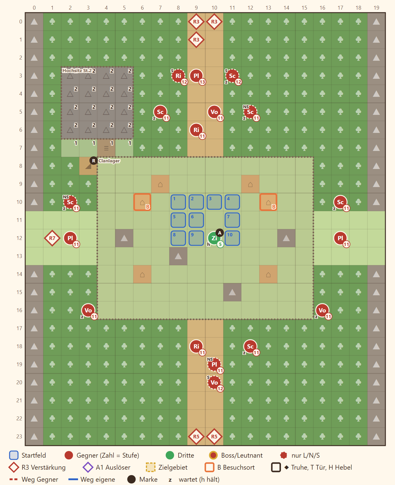

# N4 Der Clan im Schnee · Entwurf 1

**Kurz:** M 20×24 · Schnee, Nebel · 9 Runden überstehen · 8 eigene gegen 20 (2,5 : 1) · Ilka Pflicht · kein Leutnant

- **Clanlager** auf einer Lichtung, **Dravns Vorposten** kommen im Nebel aus dem Wald von allen vier Seiten.
- **Felsnase** im Nordwesten (über Rampe und Treppe): der einzige Blick über den Nebel, wer dort steht, fehlt am Lager.
- Die **Clanälteste** steht mitten im Lager und kann fallen (Nebenziel, keine Niederlage).
- Belohnung: Glutfunke und Ilkas Signaturbogen, auch in der Gedenk-Variante.

Details

| | |
|---|---|
| Gegner | L 17 · N 20 · S 23, Stufe P−3 bis P−1 (bei P 14: 11–13), Hauptmann ohne Leutnant-Rang |
| Aufstellung | 8 von 10 Feldern, Pflicht Rhen, Lucan, Ilka |
| Nebenziele | niemand fällt · beide Zelte · Älteste schützen |
| Phasen | R1–3 aus dem Nebel · R4–9 Lager halten |
| Formatwünsche | bedingte Pflichtfigur (Ilka nur, wenn sie lebt) |
| Datei | `levels/s2_n4_clan.yaml` |

**Korrektur Story 11.10 (2026-11-07):** Ilka ist Pflicht, solange sie in der Truppe ist; gefallen oder gegangen entfällt sie (gilt ohne Formatänderung, `presentForced`).
