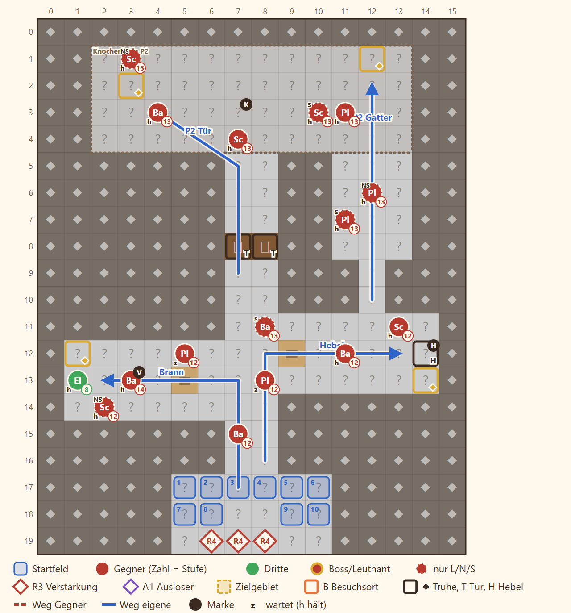

# N5 Glut unter dem Berg · Entwurf 1

**Kurz:** K 16×20 · Innen, Nebel · 4 Truhen in 12 Runden · 7 eigene gegen 15 (2,1 : 1) · Beitritt **Brann** · kein Leutnant

- **Enge Stollen**, vier Truhen in vier Winkeln: Wer alles holen will, muss sich aufteilen.
- Zur **Knochenhalle** führen die verschlossene Mitteltür (Schlüssel beim Vorarbeiter, Fenn braucht keinen) oder das **Gatter im Osten**, das ein Hebel öffnet.
- **Brann** sitzt im Westgang, Ilka oder Kael sprechen ihn an.
- In der Halle liegen **Drachenknochen** im Fels (Saat), dazu Relikt Drachenglut und Erd-Rune III.

Details

| | |
|---|---|
| Gegner | L 12 · N 15 · S 18, Stufe P−3 bis P−1 (bei P 15: 12–14), Vorarbeiter ohne Leutnant-Rang |
| Aufstellung | 7 von 10 Feldern, Pflicht Rhen und Kael |
| Nebenziele | Brann gewinnen · binnen 9 Runden · niemand fällt |
| Truhen | Drachenglut · Erd-Rune III · Chronik-Seite · Mondstahl ×3 |
| Formatwünsche | Modelle Glutader, Drachenknochen, Lore |
| Datei | `levels/s2_n5_mine.yaml` |

