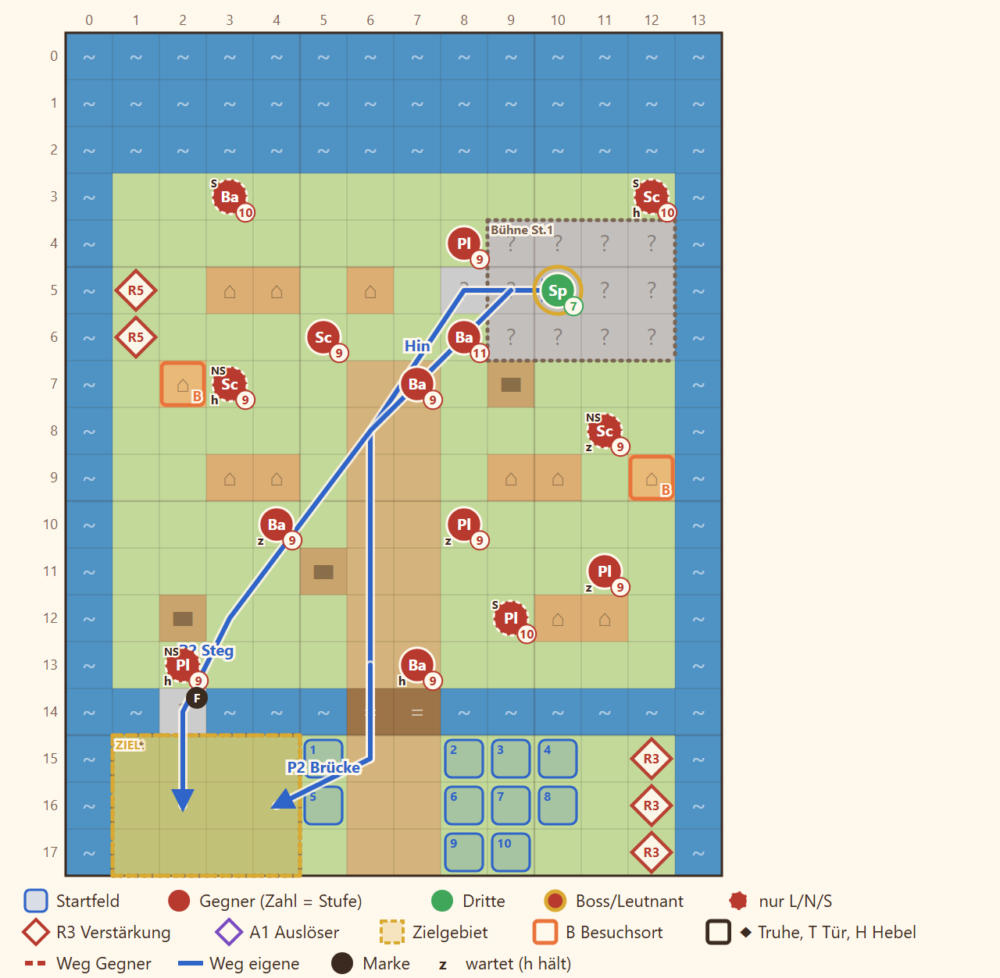

# N6 Die Gauklertruppe · Entwurf 1

**Kurz:** K 14×18 · Mittag · Gauklermeisterin zum Boot bringen · 7 eigene gegen 16 (2,3 : 1) · Jory Pflicht · **veränderliche Karte**

- **Herbstmarkt** auf der Aue-Insel: Die Truppe kommt von Süden, holt die Meisterin von der **Bühne** im Norden und bringt sie zum Boot im Südwesten.
- **Flut:** Der Steg im Westen steht in Runde 6 unter Wasser (Warnung in Runde 5), dann bleibt nur die Steinbrücke in der Mitte.
- **Schuldeneintreiber** zwischen Buden und Wagen, Boote in Runde 3 und 5.
- Belohnung: Jorys Signaturlaute, auch in der Gedenk-Variante.

Details

| | |
|---|---|
| Gegner | L 13 · N 16 · S 19, Stufe P−3 bis P−1 (bei P 12: 9–11), Anführer ohne Leutnant-Rang |
| Aufstellung | 7 von 10 Feldern, Pflicht Rhen, Kael, Jory |
| Niederlage | Rhen, Kael oder die Meisterin fallen |
| Nebenziele | niemand fällt · beide Stände besuchen |
| Phasen | R1–3 zur Bühne · R4–9 zurück zum Boot |
| Formatwünsche | bedingte Pflichtfigur (Jory nur, wenn er lebt), Modelle Bühne, Boot |
| Datei | `levels/s2_n6_gaukler.yaml` |

